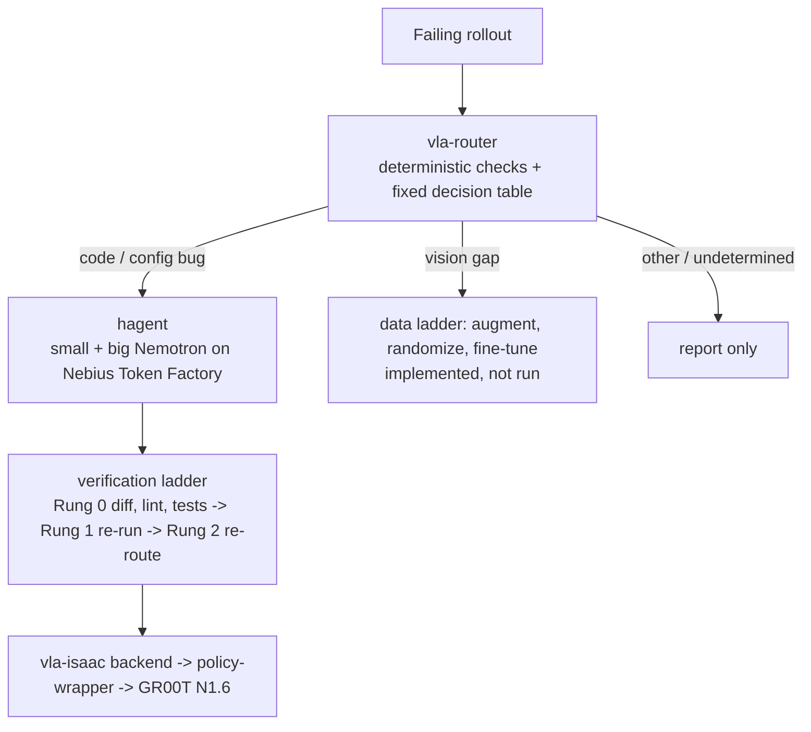

# Triage: Autonomous VLA Bug Repair

**When a robot policy fails in simulation, what broke: the code, the data, or the simulator?** Penguin Triage answers that first, with deterministic checks, and only then spends model money on a fix.

- A **router** runs contract checks (observation, config, staleness) and a fixed decision table. No model chooses the route, preventing LLM hallucinations from misdiagnosing physical simulator faults.
- For code bugs, a two-model repair agent, **hagent**, drives **Nemotron on Nebius Token Factory**: a small model (`nvidia/Nemotron-3_5-Lightning`) does almost every step, a big one (`nvidia/Nemotron-3-Ultra-550b-a55b`) is consulted rarely.
- The policy under test is **GR00T N1.6** in **Isaac Lab Arena** (GR1 fridge task).

Built for the NVIDIA Nemotron / open models on Nebius Token Factory hackathon, Physical AI track.

[](https://youtu.be/V-kMlira020?si=qriIbh9buufZeDTr)

## What we measured

One policy, one task, one GPU (RTX PRO 6000 Blackwell), small samples. Details, scripts and caveats for every row are in [docs/TECHNICAL_DETAILS.md](docs/TECHNICAL_DETAILS.md).

| Result | Number |
|---|---|
| Clean policy success | 32/40 |
| BUG-02 (image rotated 180°) | 0/30 |
| After hagent's fix (repo byte-identical to clean) | 28/40 (within noise of 32/40) |
| Injected bugs run in the simulator | 7; 3 break the policy (BUG-02, 03, 07), 4 are tolerated or mild |
| Bugs the router flags on real data | 6 of 7 (4 of them barely change success, so a success-rate monitor would miss them); BUG-03 has no detection by design |
| False positives on held-out clean runs | 0 of 3 (n tiny) |
| Automatic repair, no hand-written hint, 5 attempts per bug | BUG-02 4/5, BUG-07 2/5, BUG-03 1/5 (BUG-03 had no location, only a symptom) |
| Cost of a repair | about $0.014 (hand-hinted); about $0.09 per automatic attempt on BUG-02 |
| Lighting alone (dome light 10 or 30, default 100) | 0/20 each, against 17/20 at the default: a real vision-failure cell found with no code change |

## Honest limits

- **The router did not route end to end on real data.** `decide()` on real evidence returned `undetermined` for all three bugs, because the reference-controller replay is missing (Isaac Lab Mimic does not start on our box). That is the designed conservative behaviour, not a routing success.
- **Contract evidence cannot separate a vision gap from a code bug.** The observation check also fires on the dark-lighting cell. The replay that separates them was not run.
- **No vision failure was repaired.** The data pipeline and fine-tuning are implemented and tested on fakes only; no claim about their effect.
- Router checks and the repair loop ran as scripts outside the incident loop. Small n everywhere (3 episodes per router condition, 20 per bug, 5 repair attempts per bug).
-hagent on our SWE-rebench-V2 benchmark: hybrid did not beat small (13/39 vs 14/39) because the 550B model occasionally rejected valid code patches. This validates our architecture's reliance on deterministic simulator verification rather than LLM-based code review. The cost advantage of the two-model split remains a hypothesis.
- We wrote the bugs and the checks. Detecting injected bugs is not detecting bugs found in the wild.

The plan's headline claim (correct routing and restored held-out success, cheaper than a fixed expensive recipe) is **untested**. See [Threats to validity](docs/TECHNICAL_DETAILS.md#threats-to-validity) and [Plan versus what was done](docs/TECHNICAL_DETAILS.md#plan-versus-what-was-done).

## How it fits together



| Directory | What it is |
|---|---|
| `vla-router/` | Router, checks, decision table, verification ladder, remediation advisor ([docs/REMEDIATION.md](docs/REMEDIATION.md)) |
| `hybrid-agent/` (submodule, [hagent](https://github.com/ani26052007/hagent)) | Bash-only repair agent with a small and a big model, hard step, cost and big-call caps |
| `vla-isaac/` | Isaac Lab Arena backend, the injected-bug ledger (14 bugs + 2 combined) and `inject.py`, GPU runbook (`scripts/gpu/`) |
| `policy-wrapper/` (submodule) | The repair target: GR00T N1.6 client and server |
| `docs/` | Plan, technical details, evidence in `docs/demo_evidence/` |

## How Nemotron and Nebius are used

hagent calls Token Factory's OpenAI-compatible endpoint (`https://api.tokenfactory.nebius.com/v1/`, key in `NEBIUS_API_KEY`) for both models, so a 550B-parameter model never has to be served locally. A hand-hinted `hagent run --mode hybrid` fixed BUG-02 in 22 small-model and 3 big-model calls. Trajectories and costs are in `docs/demo_evidence/demo_bundle1/evidence/`. GR00T N1.6 is the policy under test. No Nebius service other than Token Factory is used.

## Run it

**On a laptop, no GPU, no API key** (Python 3.11+):

```bash
git clone https://github.com/ani26052007/Penguin_Triage
cd Penguin_Triage
git submodule update --init hybrid-agent policy-wrapper   # not --recursive
python3 -m venv .venv && source .venv/bin/activate
unset PYTHONPATH
pip install -e "./hybrid-agent[dev]" -e "./vla-router[dev]"
(cd vla-router && pytest -q)                     # 835 passed, 1 skipped (mocks and fakes)
python hybrid-agent/examples/demo_offline.py     # hagent fixes a one-line bug with scripted models
```

**hagent against Nebius** (never write the key to a file):

```bash
read -s NEBIUS_API_KEY; export NEBIUS_API_KEY
cd hybrid-agent
hagent run --repo /path/to/git/repo --task "Fix: add() returns the wrong value" --config config.toml --mode hybrid --trajectory out.json
```

**On a GPU**: one RTX 6000-class card with RT cores and 48 GB+ (A100/H100 are refused: no RT cores). Follow `vla-isaac/scripts/gpu/run_order.md`; Blackwell fixes are in [docs/TECHNICAL_DETAILS.md](docs/TECHNICAL_DETAILS.md#hardware-notes-for-blackwell-gpus). The simulator results have only been reproduced on that one box, and the GPU scripts have not been run as one sequence from a fresh clone.

## Evidence

Everything behind the table above (patches, hagent trajectories, Arena logs, router scripts and outputs) is in `docs/demo_evidence/`; its README says what is present and what is missing. The hagent benchmark artifacts are on the author's laptop and are not in this repository.

## License

MIT for code written for this project ([LICENSE](LICENSE)). Files copied from Isaac Lab-Arena stay Apache-2.0 (see `vla-isaac/NOTICE`, `policy-wrapper/NOTICE`). Isaac-GR00T is not copied here. Isaac Sim needs the Omniverse EULA; checkpoints come from Hugging Face under their own terms.
