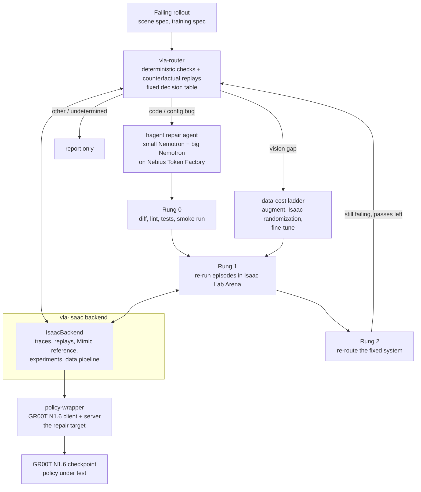

# Penguin Triage

Penguin Triage decides why a vision-language-action (VLA) policy fails a task in Isaac Sim, then repairs the cause with the cheapest tool that works. A deterministic router names the cause (code bug, vision gap, or other). For code bugs, a two-model repair agent (hagent) drives Nemotron models hosted on Nebius Token Factory: a small model does almost every step and a big model is consulted rarely. A verification ladder checks the patch before it is accepted.

Status: built and tested against mocks and fakes, and exercised once on a real GPU on 2026-10-29: a stock Arena client with GR00T N1.6 completed episodes, our policy-wrapper client ran 8-episode conditions (clean, one injected bug, after a hagent fix), and hagent fixed the injected bug with Nemotron on Nebius Token Factory. **The router has not been run on real traces, the pilot gate has not been run, and the repair task in that demo was written by hand, not produced by vla-router.** Scale is small (8 episodes per condition). See [Status](#status-what-is-verified) and [Demo evidence](#demo-evidence) before relying on any claim here.

Built for the NVIDIA Nemotron / open models on Nebius Token Factory hackathon, Physical AI track.

License: MIT for the code written for this project (see [LICENSE](LICENSE)). Files copied from Isaac Lab-Arena stay Apache-2.0. See [License and third-party notices](#license-and-third-party-notices).

## The problem and the idea

A VLA policy fails in simulation. The failure could be in the policy-side code (a swapped colour channel, a wrong action chunk length, a stale normalisation file), in the training data (the policy never saw this lighting), or somewhere that should not be "fixed" (a simulator or asset fault, a skill the policy lacks). Spending a fine-tuning run on a bug that a one-line patch fixes, or patching code when the data is the problem, wastes the whole downstream budget.

The idea:

1. **Route first.** Deterministic checks (observation, action and config contracts, staleness) and counterfactual simulator replays feed a fixed decision table. Models never decide the route (`vla-router/tests/test_no_model_in_routing.py`).
2. **Repair a code bug with a cheap model.** hagent runs a small Nemotron model for nearly every step and consults a big Nemotron model for planning, stuck advice and final review, under a hard call and cost budget.
3. **Verify in a ladder.** Rung 0 checks the patch without the simulator (diff sanity, lint, tests, smoke run, optional reviewer). Rung 1 re-runs episodes in simulation. Rung 2 re-routes the fixed system.
4. **Report, do not fix, the rest.** Action or skill gaps, new sensor modalities and simulator or infrastructure faults are detected and reported. `docs/plan.md` section 2 states this scope.

## Architecture



The router and the ladder talk to the simulator only through a `RolloutBackend` interface (`vla-router/ladder/backend.py`). The router and ladder tests use a `MockBackend`; `vla-isaac` provides the Isaac Lab Arena implementation.

## Components

| Directory | What it is |
|---|---|
| `hybrid-agent/` (git submodule, `ani26052007/hagent`) | **hagent**, a bash-only coding agent in the style of mini-swe-agent with two models. Stdlib only, any OpenAI-compatible endpoint. Hard caps on steps, cost, wall time and big-model calls; a loop detector with a stage-wise escalation ladder; history compaction; an independent final review by the big model. Its own README has the details. |
| `vla-router/` | The router and the verification ladder (`router/`, `ladder/`). Stage 1 checks (observation, action and config contracts, staleness, sanity), behaviour traces, counterfactual replays, the pure `decide(evidence, replays, config)` rule table, Rung 0/1/2, the incident loop, and the hagent repairer that turns a verdict plus evidence into a task and a patch. |
| `vla-isaac/` | The simulation side. `IsaacBackend` for Isaac Lab Arena, scene factor tables, trace sources, the Isaac Lab Mimic reference controller, experiment tools (grid, replay agreement, Wilson/Fisher statistics), the data pipeline and fine-tune launcher, the injected-bug ledger (`bugs/`), and the GPU runbook (`scripts/gpu/`). |
| `policy-wrapper/` | The repair target: a copy of Arena's GR00T N1.6 client (`Gr00tRemoteClosedloopPolicy`) with a `serve.py`, one config file (`config/eval.yaml`) and instrumentation hooks. It is its own git repository and is listed in `.gitignore` of this repo. **It is not in a fresh clone yet.** See the note under [Quick start](#quick-start-laptop-no-gpu). |
| `vla-isaac/bugs/` | The ground truth for evaluation: `ledger.yaml` lists 14 injected bugs (BUG-01 to BUG-14) and 2 combined cases, each with a patch against a fixed policy-wrapper base commit, a symptom, an expected router verdict and the check that should fire. `inject.py` applies them. `detection` says which are covered by GPU-free tests and which need a real run (the `V-bug-*` rows in `docs/VERIFY_ON_GPU.md`). |
| `docs/` | The plan (`plan.md`, `PLAN_UPDATE.md`), the pilot choice (`PILOT_AND_ORDER.md`), the implementation plan and review decisions (`IMPL_PLAN.md`), per-phase build log (`BUILD_STATUS.md`) and the list of facts to confirm on a GPU (`VERIFY_ON_GPU.md`). |
| `external/IsaacLab-Arena` (git submodule) | Isaac Lab Arena at the commit the copied files come from (`7632eb7`). |

The pilot task is the GR1 `put_item_in_fridge_and_close_door` environment with the ranch dressing bottle, checkpoint `nvidia/GN1.6-Tuned-Arena-GR1-PlaceItemCloseDoor-Task`, and dome-light changes as the vision failure family (`docs/PILOT_AND_ORDER.md`, Part 3). The choice stays provisional until the GPU gate described in `vla-isaac/scripts/gpu/run_order.md` is run. The runbook says to switch to the DROID pick-and-place task if the nominal success rate is below 0.8.

## How Nemotron and NVIDIA open models are used

- **Nemotron through Nebius Token Factory, in hagent.** `hybrid-agent/config.toml` sets the endpoint `https://api.tokenfactory.nebius.com/v1/` and the key variable `NEBIUS_API_KEY` for both roles:
  - small model `nvidia/Nemotron-3_5-Lightning` (reasoning off via `chat_template_kwargs`), which drives the main loop and compaction;
  - big model `nvidia/Nemotron-3-Ultra-550b-a55b`, which does the planning consult, stuck advice, takeover steps and the final review.
  The prices in that file are the ones the author configured; they drive the cost cap.
- **Nemotron in the router (planned, not configured).** `docs/plan.md` assigns Nemotron 3 Super to report writing and Rung 2 judging and Nemotron 3 Nano to the training-to-eval config key mapping. `vla-router/router_models.example.toml` holds placeholders for these (`REPLACE_WITH_...` model ids, `integrate.api.nvidia.com` endpoint). The model ids are unverified, and these jobs are optional: routing does not depend on them.
- **GR00T N1.6 is the policy under test**, served through `policy-wrapper/serve.py` from a checkpoint downloaded from Hugging Face. No GR00T code is copied into this repo.
- **Isaac Lab Arena, Isaac Sim, Isaac Lab and Isaac Lab Mimic** provide the environment, the rollout runner and the reference controller. `vla-isaac` drives them through Arena's own entry points.

## Where Nebius Token Factory helped

What the repository supports:

- hagent talks to Token Factory's OpenAI-compatible chat endpoint for both models. Using a hosted endpoint avoids serving a 550B-parameter model (the `Ultra-550b-a55b` id) locally.
- The two-model split is configured against the Token Factory price list (`price_in_per_mtok` / `price_out_per_mtok` in `hybrid-agent/config.toml`), with a cost cap of 1 (`max_cost`) per run.

What was measured on 2026-10-29 (details and caveats under [Demo walkthrough](#demo-walkthrough)): `hagent run --mode hybrid` with `nvidia/Nemotron-3_5-Lightning` (small) and `nvidia/Nemotron-3-Ultra-550b-a55b` (big) on Token Factory fixed an injected bug in 22 small-model calls and 3 big-model calls, at about $0.007 of small-model cost (the big-model cost is not recorded here). A first attempt with a vaguer task made 65 small-model calls (about $0.044) and edited the wrong file. Trajectories are in `docs/demo_evidence/`.

What the repository does not show: latency or rate-limit measurements, a comparison of the small, big and hybrid modes, or any SWE-bench run. Only one fix on one injected bug was run. No other Nebius service is used; the GPU box was a cloud VM, and the repository does not record which provider. See `docs/SUBMISSION.md` for the feedback section, which is the author's to fill in.

## Status: what is verified

Real-hardware session on 2026-10-29: NVIDIA RTX PRO 6000 Blackwell Server Edition (sm_120, 97 GB), driver 580.178.04, Ubuntu 22.04, cloud VM. Everything not listed as run there is "not run".

| Component | Tests (GPU-free, mocks and fakes) | Real-hardware status |
|---|---|---|
| hagent (`hybrid-agent`) | 175 passed, 19 skipped (container tests skip without Docker) | **Run live** on Nebius Token Factory: two `--mode hybrid` attempts on one injected bug (local backend; Docker not used). One fix is not a benchmark; not run on SWE-bench. |
| vla-router | 814 passed, 1 skipped against `MockBackend`, scripted hagent models and fixtures | **Not run on real traces.** Router LLM jobs: not run. Rung 1 on a simulator: not run. The repair task in the demo was written by hand, not by the router. |
| vla-isaac | 631 passed, 1 skipped before this session's changes; 640 passed, 1 skipped after (new Vulkan and cu128 checks) | Partly exercised: Arena's `policy_runner` ran episodes on `cuda:0` with cameras. `IsaacBackend`, the experiment tools, the data pipeline and the fine-tune launcher: not run. |
| policy-wrapper | 40 passed against `tests/fake_gr00t` | **Run with real GR00T N1.6**: 8 episodes per condition, seed 0, 1 env (clean 5/8, bugged 0/8, fixed 4/8). `wrapper_parity.sh` printed `parity: true` on 4 episodes, which is not meaningful (intervals too wide); the 50-episode parity run is not run. |
| Stock Arena client + GR00T N1.6 | n/a | 3 of 4 episodes succeeded (object moved 1.0, door moved 1.0). Checkpoint `nvidia/GN1.6-Tuned-Arena-GR1-PlaceItemCloseDoor-Task`, `ranch_bottle_into_fridge`. The documented 0.98 over 50 episodes is not reproduced. |
| Injected bugs | Ledger and patches tested GPU-free where `detection` is `synthetic` or `real-config` | BUG-02 injected and fixed once (see below). The other 13 bugs and 2 combined cases: not run on a GPU. |
| Isaac Lab Mimic | override check tested on fixtures | **Fails** at camera init with `--device cpu` (cameras work on `cuda:0` with `policy_runner`). Mimic is unverified. |
| Pilot gate (50 episodes, lighting probes) | n/a | Not run. |
| GPU runbook | Headers, env checks, a fake `nvidia-smi`, collector on fixtures | The scripts have not been run as a sequence; the session ran the underlying commands by hand. |
| Router + hagent end to end | `vla-router/tests/test_loop_hagent.py`: the incident loop with the real `HagentRepairer` and scripted models on a patch-aware `MockBackend` | Not run: the demo joined the pieces by hand. |

Test counts are from runs on 2026-10-29, using `env -u PYTHONPATH ~/miniconda3/envs/vla-sim/bin/python -m pytest -q` in each directory.

## Quick start (laptop, no GPU)

Nothing here needs Isaac Sim, GR00T, a GPU or an API key. Python 3.11 or newer.

```bash
git clone https://github.com/ani26052007/Penguin_Triage
cd Penguin_Triage
git submodule update --init hybrid-agent        # do not use --recursive: external/IsaacLab-Arena is large and only the GPU box needs it
python3 -m venv .venv && source .venv/bin/activate
unset PYTHONPATH                                 # a sourced ROS sets it, and its pytest plugins break collection

pip install -e "./hybrid-agent[dev]" -e "./vla-router[dev]"

(cd hybrid-agent && pytest -q)                   # hagent
(cd vla-router && pytest -q)                     # router and ladder
python hybrid-agent/examples/demo_offline.py     # hagent fixes a one-line bug with scripted models, prints the patch
```

Mock end-to-end loop (router, ladder and the real hagent repairer on a mock backend, scripted models):

```bash
cd vla-router && pytest -q tests/test_loop_hagent.py tests/test_ladder_loop.py
```

`vla-isaac` and `policy-wrapper` tests need CPU-only torch and the `policy-wrapper` checkout next to this repo. `policy-wrapper` is a separate repository that is **not yet published**:

<!-- TODO(author): publish policy-wrapper and replace this paragraph with the clone or submodule command. -->

```bash
pip install --index-url https://download.pytorch.org/whl/cpu torch==2.14.1
pip install -e ./vla-isaac[test]
# requires ./policy-wrapper (not in a fresh clone yet); then:
(cd vla-isaac && pytest -q)
(cd policy-wrapper && pytest -q)
```

vla-isaac's own README builds its environment as a clone of the author's `vla` conda env. The commands above are the equivalent plain-venv path; they have not been run from a fresh clone.

### Running hagent against Nebius Token Factory

```bash
read -s NEBIUS_API_KEY; export NEBIUS_API_KEY    # never write the key to a file
cd hybrid-agent
hagent run --repo /path/to/git/repo --task "Fix: add() returns the wrong value" --config config.toml --mode hybrid --trajectory out.json
```

`--mode small|big|hybrid` runs the same task with one model or both. The summary line on stderr gives calls and cost per model.

## GPU quick start

The scripts have not been run as a sequence. The sequence is `vla-isaac/scripts/gpu/run_order.md`; read it before spending money. Target: one RTX 6000-class GPU with RT cores and 48 GB or more (A100/H100/H200-class cards are refused: no RT cores), Linux x86_64, `uv` 0.8.4 or newer.

Prerequisites found in the 2026-10-29 session are recorded in `run_order.md` ("Box prerequisites found in the 2026-10-29 session") and summarised in [Hardware notes for Blackwell GPUs](#hardware-notes-for-blackwell-gpus). Isaac Sim needs the NVIDIA Vulkan ICD: install `libnvidia-gl-<driver major>` (`libnvidia-gl-580-server` on that box) and set `VK_ICD_FILENAMES=/usr/share/vulkan/icd.d/nvidia_icd.json` (in `env.example`; `00_check_gpu.sh` and `R0_setup.sh` check it).

```bash
cp vla-isaac/scripts/gpu/env.example ~/vla-env.sh   # edit the paths; keep it outside the repo
source ~/vla-env.sh                                  # sets RUN_TS: scripts share measurements/<RUN_TS>/ (to pin it across shells see run_order.md)
read -s NEBIUS_API_KEY; export NEBIUS_API_KEY        # only if you run hagent on this box
# export HF_TOKEN in your own shell only if the Hugging Face repos turn out to be gated

vla-isaac/scripts/gpu/00_check_gpu.sh                # GPU usable? (Ampere or newer, RT cores, VRAM)
vla-isaac/scripts/gpu/R0_setup.sh                    # Arena, GR00T and vla-isaac venvs, backend config, versions
vla-isaac/scripts/gpu/R1_download_checkpoint.sh      # GR1 pilot checkpoint from Hugging Face
# ... continue in the order of the table in run_order.md (steps 3-16)
```

Set `RUN_TS` once per session so every script writes into the same `measurements/<RUN_TS>/` directory. Scripts are idempotent, write only under `measurements/`, and finish with `result.json` and a `DONE` marker. `collect_measurements.py` (step 16) reports which `VERIFY_ON_GPU.md` rows the runs settled and the pilot decisions. The pilot gate (nominal rate at least 0.8, lighting probes dropping to about 40% or below) is checked after step 10; if it fails, the runbook says to stop and switch to DROID.

### Hardware notes for Blackwell GPUs

Found on the RTX PRO 6000 Blackwell (compute capability 12.0) and not tested on any other card:

1. **Vulkan.** Isaac Sim crashed at camera init until `libnvidia-gl-580-server` was installed and `VK_ICD_FILENAMES=/usr/share/vulkan/icd.d/nvidia_icd.json` was set.
2. **torch in the GR00T venv.** The shipped torch 2.7.1+cu126 has no sm_120 kernels (`no kernel image is available`). Installing `torch==2.7.1+cu128` and `torchvision==0.22.1+cu128` from `https://download.pytorch.org/whl/cu128` fixed it, and flash_attn 2.7.4 worked afterwards. The explicit `+cu128` is required: a plain `==2.7.1` is a no-op in uv.

`R0_setup.sh` now performs the second install when the GPU reports compute capability 12.0, and both scripts check the first; those script changes are covered by GPU-free tests and have not themselves been run.

## Demo walkthrough

What was run on 2026-10-29, with the policy-wrapper client against GR00T N1.6 (`nvidia/GN1.6-Tuned-Arena-GR1-PlaceItemCloseDoor-Task`, `ranch_bottle_into_fridge`), seed 0, 1 env, **8 episodes per condition**:

1. **Clean run.** policy-wrapper, no bug.
2. **Injected bug.** BUG-02: the image is rotated 180 degrees in `policy_wrapper/policy/gr00t_core.py`, function `build_gr00t_policy_observations`, by `[:, ::-1, ::-1]`.
3. **Bugged run.** The policy fails every episode.
4. **hagent fix.** `hagent run --mode hybrid`, small `nvidia/Nemotron-3_5-Lightning`, big `nvidia/Nemotron-3-Ultra-550b-a55b`, both on Nebius Token Factory, local backend.
5. **Fixed run.** Same seed and episodes after applying the patch.

| Condition | Success | Object moved | Door moved |
|---|---|---|---|
| policy-wrapper, clean | 5/8 = 0.625 | not recorded here | not recorded here |
| policy-wrapper, BUG-02 | 0/8 = 0.0 | 0.0 | 0.0 |
| policy-wrapper, after hagent fix | 4/8 = 0.5 | 1.0 | 1.0 |
| stock Arena client (4 episodes) | 3/4 | 1.0 | 1.0 |

With 8 episodes per condition, 0.5 and 0.625 cannot be told apart; the result shows that the bug removes all successes and that the fix restores behaviour of the same order as clean, not that the fix restores the clean rate exactly. Task completion fractions are reported as measured; their definitions are Arena's.

The hagent attempts:

| Attempt | Task | Small-model calls | Big-model calls | Cost | Outcome |
|---|---|---|---|---|---|
| 1 | Vague ("observation path"), `task_bug02.md` | 65 | not recorded here | about $0.044 | Edited `utils/image_conversion.py`: wrong |
| 2 | Names `build_gr00t_policy_observations` in `gr00t_core.py`, `task_bug02b.md` | 22 | 3 | about $0.007 (small model only) | `exit_status` Submitted; removed the `[:, ::-1, ::-1]` and nothing else (`bug02_fix.patch`) |

**What was not automatic.** The router did not run on real traces. Both task texts were written by hand from measured results, in the style of a router task. The second task contained a localization hint (the function and file), so attempt 2 shows that hagent applies a correctly located fix cheaply, not that the system locates the bug. Docker was not used.

The intended full loop, not run end to end on real hardware: the router runs the Stage 1 checks and replays and names the verdict and location (for BUG-02 the ledger expects `code`); the verdict and evidence become the hagent task; Rung 0 checks the patch, Rung 1 re-runs episodes, and Rung 2 re-routes the fixed system. For a combined case (CASE-01), the ledger expects the first fix to expose a second cause, which the second pass routes to `vision`.

## Demo evidence

Files for the run above, in `docs/demo_evidence/` (to be copied there by the author; not present when this section was written):

- `bug02_fix.patch`: the patch hagent produced in attempt 2.
- `task_bug02.md`: the vague task of attempt 1.
- `task_bug02b.md`: the task of attempt 2, with the localization hint.
- `hagent_bug02_attempt1_traj.json`: the trajectory of attempt 1.
- `hagent_bug02_traj.json`: the trajectory of attempt 2.

## Known limitations

From `docs/BUILD_STATUS.md`, "Current state" and Phase 8 "Limitations" (not softened):

- A stripped recorded-variation file is not replayed through `IsaacBackend`; restoring a factor live covers the same need.
- The staleness checks see only action-side delay.
- `FrameStats.missing_texture_fraction` is not measured.
- The Mimic override check is indirect (camera brightness), because Mimic records no variations. It reports `inconclusive`, not pass, when frames are missing or all black.
- The GR1 hand sign and the joint-YAML swap are detectable only by elimination.
- The Docker path of the repairer has not been run (no image; `vla-router/DECISIONS.md`); the session's hagent runs used the local backend.
- The demo's repair task was written by hand with a localization hint; the router-to-hagent hand-off has not run on real data.
- Results are 8 episodes per condition (4 for the stock client); the pilot gate (50 episodes) and wrapper parity at a meaningful size are not run.
- Isaac Lab Mimic fails at camera init with `--device cpu`, so the Mimic reference is unverified.
- The pilot is a composite task (pick and place, then close door). Its close-door subtask has no slot in `BehaviorTrace.PHASES`, the GR1 scene has no camera-variation family, and the documented 0.98 success may come from a 1-GPU or 2-GPU run (`docs/PILOT_AND_ORDER.md`).
- The agent runs arbitrary bash. Use the container backend for anything untrusted. hagent is POSIX only.
- Costs and token budgets are only as accurate as the configured prices; with prices at 0 the cost cap never triggers.
- Everything under [Status](#status-what-is-verified) marked "not run" is unmeasured. Expect further GPU runs to find defects.

## License and third-party notices

- Code written for this project: MIT (`LICENSE`). `hybrid-agent/` is a separate repository and currently has no license file of its own. `policy-wrapper/` declares Apache-2.0.
- Files copied from Isaac Lab-Arena (commit `7632eb7d5e`, Apache-2.0, copyright The Isaac Lab Arena Project Developers) keep their original headers. They are listed in `vla-isaac/NOTICE` and in `policy-wrapper/NOTICE`, with the changes made to each.
- **Isaac-GR00T is licensed under the NVIDIA License and no part of it is copied into this repository.** `policy-wrapper/serve.py` imports it at run time from a separate install; `policy-wrapper/tests/fake_gr00t` holds test stand-ins written here.
- Isaac Sim requires accepting the Omniverse EULA (`OMNI_KIT_ACCEPT_EULA=YES`, `ACCEPT_EULA=Y`). Model checkpoints and datasets are downloaded from Hugging Face under their own terms and are not redistributed here.
