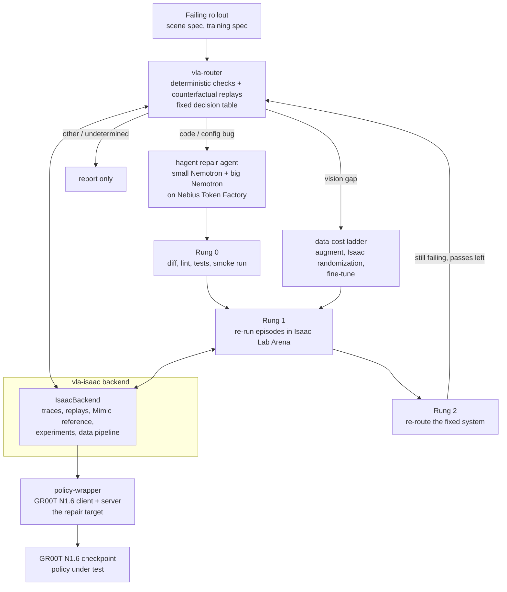

# Penguin Triage

Penguin Triage decides why a vision-language-action (VLA) policy fails a task in Isaac Sim, then repairs the cause with the cheapest tool that works. A deterministic router names the cause (code bug, vision gap, or other). For code bugs, a two-model repair agent (hagent) drives Nemotron models hosted on Nebius Token Factory: a small model does almost every step and a big model is consulted rarely. A verification ladder checks the patch before it is accepted.

Status: built and tested against mocks and fakes, and exercised on a real GPU in a session on 2026-10-29/30 (a Spot VM, preempted several times). Measured on that box, at small scale:

- Policy under test: policy-wrapper with GR00T N1.6 completes the task, clean 32/40; the stock Arena client completed 3 of 4 episodes.
- Injected bugs: 7 bugs ran in the simulator; 3 break the policy (BUG-02 0/30, BUG-03 0/20, BUG-07 0/20) and 4 are tolerated or mild.
- Detection: the router's observation check flags BUG-01 and BUG-02, its config check flags BUG-05, BUG-06 and BUG-07, its staleness probe (constant-delay half) flags BUG-09. That is 6 of 7 bugs on real data, 4 of them (01, 05, 06, 09) bugs the policy tolerates or only mildly suffers from; BUG-03 has no detection by design. False positives on held-out clean runs: 0 of 3 (n tiny).
- Lighting: with the dome light at intensity 10 or 30 (default 100) the policy succeeds in 0/20 episodes each, against 17/20 on the same seeds at the default. This is a real vision-failure cell found with no code change. Intensity 1000 gives 11/20, a partial drop that is suggestive, not established (Fisher p about 0.1).
- The same observation check also fires on that dark cell (value range and colour balance), so contract evidence alone cannot tell a vision gap from a code bug. The replay that separates them (one-factor restore) was not run.
- `decide()` on real evidence returns `undetermined` (row 10) for BUG-02, BUG-07 and BUG-03, because the reference-controller replay (G2) is missing. This is the designed conservative behaviour, not a routing success.
- Automatic repair: hagent on Nebius Token Factory, no hand-written hint, 5 attempts per bug: BUG-02 4/5, BUG-07 2/5, BUG-03 1/5 (symptom-only task).
- hagent benchmark on SWE-rebench-V2 (laptop, 23 tasks): hybrid did not beat small (13/39 vs 14/39 on the fair set).

Not run: Stage 0 and Stage 2 driven by the router on the simulator, Branch G and Branch C replays, the reference controller (Isaac Lab Mimic does not start on this box), the other Stage 1 checks on real data (see [Plan versus what was done](#plan-versus-what-was-done)), Rung 1 and Rung 2, the incident loop, the 50-episode pilot gate (the smaller sample meets its two conditions; the gate was not formally run), `IsaacBackend` end to end, the experiment tools, and the data pipeline and fine-tuning (implemented, not run, no claim about its effect). No vision failure was repaired. Router checks ran from scripts assembled outside `IsaacBackend`; the automatic repair loop is a script outside the incident loop. The plan's headline claim (correct routing and restored held-out success, at lower cost than a fixed expensive recipe) is untested. A deterministic remediation advisor lists options for non-code verdicts ([docs/REMEDIATION.md](docs/REMEDIATION.md)); none of its data or fine-tuning paths was run. See [Status](#status-what-is-verified), [Plan versus what was done](#plan-versus-what-was-done), [Threats to validity](#threats-to-validity) and [Demo evidence](#demo-evidence) before relying on any claim here.

Built for the NVIDIA Nemotron / open models on Nebius Token Factory hackathon, Physical AI track.

License: MIT for the code written for this project (see [LICENSE](LICENSE)). Files copied from Isaac Lab-Arena stay Apache-2.0. See [License and third-party notices](#license-and-third-party-notices).

## The problem and the idea

A VLA policy fails in simulation. The failure could be in the policy-side code (a swapped colour channel, a wrong action chunk length, a stale normalisation file), in the training data (the policy never saw this lighting), or somewhere that should not be "fixed" (a simulator or asset fault, a skill the policy lacks). Spending a fine-tuning run on a bug that a one-line patch fixes, or patching code when the data is the problem, wastes the whole downstream budget.

The idea:

1. **Route first.** Deterministic checks (observation, action and config contracts, staleness) and counterfactual simulator replays feed a fixed decision table. Models never decide the route (`vla-router/tests/test_no_model_in_routing.py`).
2. **Repair a code bug with a cheap model.** hagent runs a small Nemotron model for nearly every step and consults a big Nemotron model for planning, stuck advice and final review, under a hard call and cost budget.
3. **Verify in a ladder.** Rung 0 checks the patch without the simulator (diff sanity, lint, tests, smoke run, optional reviewer). Rung 1 re-runs episodes in simulation. Rung 2 re-routes the fixed system.
4. **Report, do not fix, the rest.** Action or skill gaps, new sensor modalities and simulator or infrastructure faults are detected and reported. `docs/plan.md` section 2 states this scope.

## Architecture



The router and the ladder talk to the simulator only through a `RolloutBackend` interface (`vla-router/ladder/backend.py`). The router and ladder tests use a `MockBackend`; `vla-isaac` provides the Isaac Lab Arena implementation.

## Components

| Directory | What it is |
|---|---|
| `hybrid-agent/` (git submodule, `ani26052007/hagent`) | **hagent**, a bash-only coding agent in the style of mini-swe-agent with two models. Stdlib only, any OpenAI-compatible endpoint. Hard caps on steps, cost, wall time and big-model calls; a loop detector with a stage-wise escalation ladder; history compaction; an independent final review by the big model. Its own README has the details. |
| `vla-router/` | The router and the verification ladder (`router/`, `ladder/`). Stage 1 checks (observation, action and config contracts, staleness, sanity), behaviour traces, counterfactual replays, the pure `decide(evidence, replays, config)` rule table, Rung 0/1/2, the incident loop, and the hagent repairer that turns a verdict plus evidence into a task and a patch. `router/remediation.py` lists remediation options for non-code verdicts from a fixed table (no model; [docs/REMEDIATION.md](docs/REMEDIATION.md)). |
| `vla-isaac/` | The simulation side. `IsaacBackend` for Isaac Lab Arena, scene factor tables, trace sources, the Isaac Lab Mimic reference controller, experiment tools (grid, replay agreement, Wilson/Fisher statistics), the data pipeline and fine-tune launcher, the injected-bug ledger (`bugs/`), and the GPU runbook (`scripts/gpu/`). |
| `policy-wrapper/` (git submodule, `ani26052007/policy-wrapper`) | The repair target: a copy of Arena's GR00T N1.6 client (`Gr00tRemoteClosedloopPolicy`) with a `serve.py`, one config file (`config/eval.yaml`) and instrumentation hooks. It is its own git repository, pinned by the submodule pointer. The pointer must be a pushed public commit; the current one (`56f919a`) is on `origin/main`. |
| `vla-isaac/bugs/` | The ground truth for evaluation: `ledger.yaml` lists 14 injected bugs (BUG-01 to BUG-14) and 2 combined cases, each with a patch against a fixed policy-wrapper base commit, a symptom, an expected router verdict and the check that should fire. `inject.py` applies them. `detection` says which are covered by GPU-free tests and which need a real run (the `V-bug-*` rows in `docs/VERIFY_ON_GPU.md`). |
| `docs/` | The plan (`plan.md`, `PLAN_UPDATE.md`), the remediation menu (`REMEDIATION.md`), the pilot choice (`PILOT_AND_ORDER.md`), the implementation plan and review decisions (`IMPL_PLAN.md`), per-phase build log (`BUILD_STATUS.md`) and the list of facts to confirm on a GPU (`VERIFY_ON_GPU.md`). |
| `external/IsaacLab-Arena` (git submodule) | Isaac Lab Arena at the commit the copied files come from (`7632eb7`). |

The pilot task is the GR1 `put_item_in_fridge_and_close_door` environment with the ranch dressing bottle, checkpoint `nvidia/GN1.6-Tuned-Arena-GR1-PlaceItemCloseDoor-Task`, and dome-light changes as the vision failure family (`docs/PILOT_AND_ORDER.md`, Part 3). The choice stays provisional until the GPU gate described in `vla-isaac/scripts/gpu/run_order.md` is run. The runbook says to switch to the DROID pick-and-place task if the nominal success rate is below 0.8.

## How Nemotron and NVIDIA open models are used

- **Nemotron through Nebius Token Factory, in hagent.** `hybrid-agent/config.toml` sets the endpoint `https://api.tokenfactory.nebius.com/v1/` and the key variable `NEBIUS_API_KEY` for both roles:
  - small model `nvidia/Nemotron-3_5-Lightning` (reasoning off via `chat_template_kwargs`), which drives the main loop and compaction;
  - big model `nvidia/Nemotron-3-Ultra-550b-a55b`, which does the planning consult, stuck advice, takeover steps and the final review.
  The prices in that file are the ones the author configured; they drive the cost cap.
- **Nemotron in the router (planned, not configured).** `docs/plan.md` assigns Nemotron 3 Super to report writing and Rung 2 judging and Nemotron 3 Nano to the training-to-eval config key mapping. `vla-router/router_models.example.toml` holds placeholders for these (`REPLACE_WITH_...` model ids, `integrate.api.nvidia.com` endpoint). The model ids are unverified, and these jobs are optional: routing does not depend on them.
- **GR00T N1.6 is the policy under test**, served through `policy-wrapper/serve.py` from a checkpoint downloaded from Hugging Face. No GR00T code is copied into this repo.
- **Isaac Lab Arena, Isaac Sim, Isaac Lab and Isaac Lab Mimic** provide the environment, the rollout runner and the reference controller. `vla-isaac` drives them through Arena's own entry points.

## Where Nebius Token Factory helped

What the repository supports:

- hagent talks to Token Factory's OpenAI-compatible chat endpoint for both models. Using a hosted endpoint avoids serving a 550B-parameter model (the `Ultra-550b-a55b` id) locally.
- The two-model split is configured against the Token Factory price list (`price_in_per_mtok` / `price_out_per_mtok` in `hybrid-agent/config.toml`), with a cost cap of 1 (`max_cost`) per run.

What was measured on 2026-10-29 (details and caveats under [Demo walkthrough](#demo-walkthrough)): `hagent run --mode hybrid` with `nvidia/Nemotron-3_5-Lightning` (small) and `nvidia/Nemotron-3-Ultra-550b-a55b` (big) on Token Factory fixed an injected bug in 22 small-model calls and 3 big-model calls: about $0.0072 of small-model cost and about $0.0064 of big-model cost (from `usage` in `hagent_bug02_traj.json`), about $0.014 in total. A first attempt with a vaguer task made 65 small-model calls and 4 big-model calls (about $0.044 and $0.026 from `usage` in its trajectory) and edited the wrong file. The trajectory files are in `docs/demo_evidence/demo_bundle1/evidence/`; see [Demo evidence](#demo-evidence).

What the repository does not show: latency or rate-limit measurements, or any SWE-bench Verified run. hagent has been run live many times, not as one fix on one bug: the small, big and hybrid modes were compared on a separate benchmark (SWE-rebench-V2, 23 tasks; see [hagent benchmark](#hagent-benchmark)), where the big model added nothing measurable in hybrid mode and hybrid (13/39) did not beat small (14/39) on the fair set. A cost advantage of hybrid is a hypothesis; this benchmark does not support it. The later automatic-repair runs (see [Automatic repair](#automatic-repair-no-hand-written-hint)) used the same two models: 5 attempts per bug on 3 bugs, each attempt costing about $0.03-0.20 by the `usage` totals; the five attempts cost $0.443 (BUG-02), $0.635 (BUG-07) and $0.493 (BUG-03) in total. These are results for hagent on Token Factory, not evidence that the hybrid scheme is better than a single model. No other Nebius service is used; the GPU box was a cloud VM, and the repository does not record which provider. See `docs/SUBMISSION.md` for the feedback section, which is the author's to fill in.

## Status: what is verified

Real-hardware session on 2026-10-29: NVIDIA RTX PRO 6000 Blackwell Server Edition (sm_120, 97 GB), driver 580.178.04, Ubuntu 22.04, cloud VM. Everything not listed as run there is "not run".

| Component | Tests (GPU-free, mocks and fakes) | Real-hardware status |
|---|---|---|
| hagent (`hybrid-agent`) | 175 passed, 19 skipped (container tests skip without Docker; scripted models, separate from the live runs) | **Run live many times**, not one fix on one bug: the SWE-rebench-V2 subset (see [hagent benchmark](#hagent-benchmark); results from the author's laptop, Docker backend), two hand-hinted `--mode hybrid` attempts on BUG-02 and 15 automatic attempts (5 each on BUG-02, BUG-07, BUG-03; see [Automatic repair](#automatic-repair-no-hand-written-hint)) on the GPU box (local backend). Not run on SWE-bench Verified. The repo's own pytest was not run on the VM (missing dependencies, collection errors). |
| vla-router | 835 passed, 1 skipped against `MockBackend`, scripted hagent models and fixtures (814 before the remediation advisor, +21 tests) | **Run on real data, from scripts outside `IsaacBackend`:** the observation-contract check (clean seed-11 nominal; BUG-01, BUG-02, BUG-09, the dark lighting cell and 3 held-out clean runs; see [Router evidence on real frames](#router-evidence-on-real-frames) and [More router checks](#more-router-checks-on-real-runs)), the config-contract check on real bugged repos ([Config check on real repos](#config-check-on-real-repos)), the constant-delay half of the staleness probe, and `decide()` called directly on real evidence ([Decision table on real evidence](#decision-table-on-real-evidence)). **Not run on real data:** Stage 0 and Stage 2 replays, Branch G and Branch C, the variable-delay half of the staleness probe, the sanity check, the action contract's joint-tracking part, Rung 0/1/2, the incident loop and the router LLM jobs. |
| vla-isaac | 643 passed, 1 skipped on 2026-10-29 with policy-wrapper at the ledger's base commit. On 2026-10-30 the local policy-wrapper is at `56f919a` (history rewritten, tree identical to `5b4b93e`), so the tests that need the ledger's base commit skipped: 534 passed, 110 skipped, then 567 passed, 110 skipped after the `inject.py` statistics, pass@k, config-check and auto-repair script tests. After the ledger gained `base_tree` and the tests began comparing tree hashes, **676 passed, 1 skipped** (2026-10-30 run on this checkout; the 109 formerly skipped tests now run). Run against a clone checked out at `5b4b93e`, `test_injected_bugs.py` and `test_policy_wrapper_pins.py` gave 116 passed | Instrumentation files and trace reading (`read_instrument_dir`) ran on real data. Arena's `policy_runner` ran episodes on `cuda:0` with cameras. `IsaacBackend` end to end, the experiment tools (grid, agreement, mode gap), the data pipeline and the fine-tune launcher: not run. |
| policy-wrapper | 40 passed against `tests/fake_gr00t` | **Run with real GR00T N1.6**: clean 32/40 over 4 seeds (10 episodes each, 1 env per process). `wrapper_parity.sh` printed `parity: true` on 4 episodes, which is not meaningful (intervals too wide); the 50-episode parity run is not run. |
| Stock Arena client + GR00T N1.6 | n/a | 3 of 4 episodes succeeded (object moved 1.0, door moved 1.0). Checkpoint `nvidia/GN1.6-Tuned-Arena-GR1-PlaceItemCloseDoor-Task`, `ranch_bottle_into_fridge`. The documented 0.98 over 50 episodes is not reproduced (only 4 episodes run). |
| Injected bugs | Ledger and patches tested GPU-free where `detection` is `synthetic` or `real-config` | 7 of 14 bugs ran in the simulator (01, 02, 03, 05, 06, 07, 09; see [Bug suite](#bug-suite)): 3 break the policy (02, 03, 07), 4 are tolerated or mild. The router flags 6 of the 7 on real data (BUG-03 has no detection by design); see [More router checks](#more-router-checks-on-real-runs). BUG-02 was fixed by hagent (28/40), and automatic repair ran on BUG-02, BUG-07 and BUG-03. The other 7 bugs and the 2 combined cases: not run. BUG-10 additionally cannot run as is (the helper script passes `--language_instruction` on the command line, which overrides `eval.yaml`). |
| Isaac Lab Mimic | override check tested on fixtures | **Fails** at camera init with `--device cpu` and with `--device cuda:0` (`Invalid object in Py_Graph in getWrappedGraphFromNode`). A nominal run (no lighting override, no `--viz none`) fails with the same SDGPipeline / Py_Graph error on both devices, and app-profile greps showed no difference between the Mimic and `policy_runner` launchers. Unresolved. Mimic reference: unverified. Mimic-based data generation (Rung B) is blocked on this box. |
| Pilot gate (50 episodes, lighting probes) | n/a | **Gate not formally run;** clean 0.80 over 40 episodes and a lighting cell at 0/20 meet its two conditions in a smaller sample. Lighting sweep on policy-wrapper (dome-light intensity 10, 30, 1000; seeds 1-2; 10 episodes per seed): 0/20, 0/20, 11/20; clean on the same seeds 17/20 (see [Lighting sweep](#lighting-sweep)). A vision-failure cell exists (intensity 10 and 30); it was not repaired. |
| GPU runbook | Headers, env checks, a fake `nvidia-smi`, collector on fixtures | Run on the box: `00_check_gpu`, `R0_setup`, `R1`, `R1b`, `R2_server`, `R3_list_variations`, `wrapper_parity` (4 episodes). `check_client_tests` reported ok but is not settled (collection error in the vla venv, no pytest in the GR00T venv; the script now reports `not_settled`, covered by GPU-free tests only). Not run: `R4`/`R8`/`R7`/`R7b`, `instruction_check`, `runner_parity`, `R5`, `R6`, `finetune_dryrun`. The session mostly ran the underlying commands by hand. |
| Router + hagent end to end | `vla-router/tests/test_loop_hagent.py`: the incident loop with the real `HagentRepairer` and scripted models on a patch-aware `MockBackend` | Partly run, by scripts outside the incident loop: router evidence -> `write_report` (Nemotron small) -> `hagent solve` -> scripted check, 5 attempts each for BUG-02, BUG-07, BUG-03 (see [Automatic repair](#automatic-repair-no-hand-written-hint)). `decide()` was called on real evidence and returned `undetermined` (G2 missing). The incident loop itself, Rung 0/1/2 and the router's own verdict step did not drive these runs. |
| Remediation advisor | `vla-router/tests/test_remediation.py` (21 tests) | Not applicable (deterministic, no model). It lists options for vision, action-gap and perception verdicts; none of the data or fine-tuning paths it lists was run. See [docs/REMEDIATION.md](docs/REMEDIATION.md). |
| Data pipeline and fine-tuning (mixer, held-out split, Rung A presets, Rung B Mimic regeneration, launcher with official GR00T flags, `finetune_dryrun.sh`) | Implemented and tested on fakes only | **Implemented, not run, no claim about its effect.** Reasons: the time budget went to detection and repair; Mimic, which Rung B needs, does not start on this box; the injected code bugs are not fixed by fine-tuning. The launcher and mixer are our code, and GR00T run-to-run variance is reported at 5-6 points. Now that a vision-failure cell exists, a short Rung A fine-tune on that cell is the natural next experiment; it was not run. |

Test counts are from runs on 2026-10-29 and 2026-10-30 (as stated per row), using `env -u PYTHONPATH ~/miniconda3/envs/vla-sim/bin/python -m pytest -q` in each directory.

## Quick start (laptop, no GPU)

Nothing here needs Isaac Sim, GR00T, a GPU or an API key. Python 3.11 or newer.

```bash
git clone https://github.com/ani26052007/Penguin_Triage
cd Penguin_Triage
git submodule update --init hybrid-agent policy-wrapper   # do not use --recursive: external/IsaacLab-Arena is large and only the GPU box needs it
python3 -m venv .venv && source .venv/bin/activate
unset PYTHONPATH                                 # a sourced ROS sets it, and its pytest plugins break collection

pip install -e "./hybrid-agent[dev]" -e "./vla-router[dev]"

(cd hybrid-agent && pytest -q)                   # hagent
(cd vla-router && pytest -q)                     # router and ladder
python hybrid-agent/examples/demo_offline.py     # hagent fixes a one-line bug with scripted models, prints the patch
```

Mock end-to-end loop (router, ladder and the real hagent repairer on a mock backend, scripted models):

```bash
cd vla-router && pytest -q tests/test_loop_hagent.py tests/test_ladder_loop.py
```

`vla-isaac` and `policy-wrapper` tests need CPU-only torch and the `policy-wrapper` submodule (initialised above). The submodule pointer must be a pushed public commit; if you change policy-wrapper, push it before committing the new pointer here.

```bash
pip install --index-url https://download.pytorch.org/whl/cpu torch==2.14.1
pip install -e ./vla-isaac[test]
(cd vla-isaac && pytest -q)
(cd policy-wrapper && pytest -q)
```

vla-isaac's own README builds its environment as a clone of the author's `vla` conda env. The commands above are the equivalent plain-venv path; they have not been run from a fresh clone.

### Running hagent against Nebius Token Factory

```bash
read -s NEBIUS_API_KEY; export NEBIUS_API_KEY    # never write the key to a file
cd hybrid-agent
hagent run --repo /path/to/git/repo --task "Fix: add() returns the wrong value" --config config.toml --mode hybrid --trajectory out.json
```

`--mode small|big|hybrid` runs the same task with one model or both. The summary line on stderr gives calls and cost per model.

## GPU quick start

The scripts have not been run as a sequence. The sequence is `vla-isaac/scripts/gpu/run_order.md`; read it before spending money. Target: one RTX 6000-class GPU with RT cores and 48 GB or more (A100/H100/H200-class cards are refused: no RT cores), Linux x86_64, `uv` 0.8.4 or newer.

Prerequisites found in the 2026-10-29 session are recorded in `run_order.md` ("Box prerequisites found in the 2026-10-29 session") and summarised in [Hardware notes for Blackwell GPUs](#hardware-notes-for-blackwell-gpus). Isaac Sim needs the NVIDIA Vulkan ICD: install `libnvidia-gl-<driver major>` (`libnvidia-gl-580-server` on that box) and set `VK_ICD_FILENAMES=/usr/share/vulkan/icd.d/nvidia_icd.json` (in `env.example`; `00_check_gpu.sh` and `R0_setup.sh` check it).

```bash
cp vla-isaac/scripts/gpu/env.example ~/vla-env.sh   # edit the paths; keep it outside the repo
source ~/vla-env.sh                                  # sets RUN_TS: scripts share measurements/<RUN_TS>/ (to pin it across shells see run_order.md)
read -s NEBIUS_API_KEY; export NEBIUS_API_KEY        # only if you run hagent on this box
# export HF_TOKEN in your own shell only if the Hugging Face repos turn out to be gated

vla-isaac/scripts/gpu/00_check_gpu.sh                # GPU usable? (Ampere or newer, RT cores, VRAM)
vla-isaac/scripts/gpu/R0_setup.sh                    # Arena, GR00T and vla-isaac venvs, backend config, versions
vla-isaac/scripts/gpu/R1_download_checkpoint.sh      # GR1 pilot checkpoint from Hugging Face
# ... continue in the order of the table in run_order.md (steps 3-16)
```

Set `RUN_TS` once per session so every script writes into the same `measurements/<RUN_TS>/` directory. Scripts are idempotent, write only under `measurements/`, and finish with `result.json` and a `DONE` marker. `collect_measurements.py` (step 16) reports which `VERIFY_ON_GPU.md` rows the runs settled and the pilot decisions. The pilot gate (nominal rate at least 0.8, lighting probes dropping to about 40% or below) is checked after step 10; if it fails, the runbook says to stop and switch to DROID.

### Hardware notes for Blackwell GPUs

Found on the RTX PRO 6000 Blackwell (compute capability 12.0) and not tested on any other card:

1. **Vulkan.** Isaac Sim crashed at camera init until `libnvidia-gl-580-server` was installed and `VK_ICD_FILENAMES=/usr/share/vulkan/icd.d/nvidia_icd.json` was set.
2. **torch in the GR00T venv.** The shipped torch 2.7.1+cu126 has no sm_120 kernels (`no kernel image is available`). Installing `torch==2.7.1+cu128` and `torchvision==0.22.1+cu128` from `https://download.pytorch.org/whl/cu128` fixed it, and flash_attn 2.7.4 worked afterwards. The explicit `+cu128` is required: a plain `==2.7.1` is a no-op in uv.

`R0_setup.sh` now performs the second install when the GPU reports compute capability 12.0, and both scripts check the first; those script changes are covered by GPU-free tests and have not themselves been run.

Other notes from the session:

3. **Arena's nested submodules use SSH URLs.** `R0_setup` needed `git config --global url."https://github.com/".insteadOf git@github.com:` on a box without GitHub SSH keys.
4. **`R2_server.sh | tail` hangs.** The server keeps the pipe open. Redirect to a file instead (`R2_server.sh > r2.log 2>&1`). The server answered ping after 8-14 s.
5. **Start parallel runs 60 s apart.** Three simulators starting at once collided on an HDF5 file lock (h5py "unable to lock file"); the crashed run was rerun alone and succeeded. Clean and bug-suite runs ran as separate processes with `--num_envs 1` and different `--seed`, started 60 s apart. Three parallel runs peaked at 52 GB VRAM and 98% GPU utilisation.
6. **The VM was a Spot instance and was preempted several times.** Results were bundled to the laptop between runs, and `~/.vla_run_ts` pinned `RUN_TS` across restarts. A preemption cost the first lighting sweep, which was rerun later in the session (see [Lighting sweep](#lighting-sweep)).

## Demo walkthrough

What was run on 2026-10-29: the policy-wrapper client against GR00T N1.6 (`nvidia/GN1.6-Tuned-Arena-GR1-PlaceItemCloseDoor-Task`, `ranch_bottle_into_fridge`), clean mode, 1 env per process, separate processes (up to three in parallel), 10 episodes per seed, seed passed with `--seed`.

1. **Clean run.** policy-wrapper, no bug.
2. **Injected bug.** BUG-02: the image is rotated 180 degrees in `policy_wrapper/policy/gr00t_core.py`, function `build_gr00t_policy_observations`, by `[:, ::-1, ::-1]`.
3. **Bugged run.** The policy succeeds in no episode.
4. **hagent fix.** `hagent run --mode hybrid`, small `nvidia/Nemotron-3_5-Lightning`, big `nvidia/Nemotron-3-Ultra-550b-a55b`, both on Nebius Token Factory, local backend (the VM had no Docker), `hybrid-agent/config.toml`.
5. **Fixed run.** The same protocol (seeds 1-4, 10 episodes each) after applying the patch. The fixed repo was verified byte-identical to the clean repo (`diff -rq`).
6. **BUG-01 for contrast.** `config/eval.yaml` `bgr_conversion` false to true (RGB/BGR swap).

| Condition | Per-seed successes (of 10) | Success | Object moved | Door moved |
|---|---|---|---|---|
| policy-wrapper, clean | seeds 1-4: 9, 8, 9, 6 | 32/40 = 0.80 (Wilson 95% about 0.65-0.90) | 1.0 on all | 1.0 on all |
| policy-wrapper, BUG-02 | seeds 1-3: 0, 0, 0 | 0/30 = 0.0 | 0.0 | 0.0 |
| policy-wrapper, after hagent fix | seeds 1-4: 7, 8, 6, 7 | 28/40 = 0.70 | about 1.0 (0.9 for one seed) | 1.0 |
| policy-wrapper, BUG-01 (channel swap) | seeds 1-3: 7, 9, 6 | 22/30 = 0.73 | 1.0 | 1.0 |
| stock Arena client (4 episodes) | one run | 3/4 | 1.0 | 1.0 |

Reading the table: the bug removes every success and both behaviour rates fall to 0.0; after the fix success is back in the clean range and both behaviour rates are back to about 1.0. Clean 32/40 against fixed 28/40 is a difference within noise (Fisher p about 0.4), and the two repos are byte-identical, so the 0.70 vs 0.80 gap is run-to-run variation, not a residual defect. This is not "fully recovered" with a demonstrated rate. BUG-01 is **not** a fix demonstration: the policy tolerates the channel swap (22/30 is within the clean range), although the router flags it (below). Task completion fractions are reported as measured; their definitions are Arena's.

Footnote: earlier seed-0 runs with 8 episodes (clean 5/8, BUG-02 0/8, fixed 4/8) are superseded by the runs above.

Video: Arena's `--record_camera_video` records the simulator's robot point-of-view camera, not the image the client sends to the model, so the bugged clip looks like a normal scene with a flailing robot. It does not show an upside-down view.

The hagent attempts (costs from `usage` in the trajectories):

| Attempt | Task | Small-model calls (cost) | Big-model calls (cost) | Outcome |
|---|---|---|---|---|
| 1 | Vague ("observation path"), `task_bug02.md` | 65 (about $0.044) | 4 (about $0.026) | `exit_status` Submitted but wrong: edited `policy_wrapper/utils/image_conversion.py`; the flip was still present |
| 2 | Names `policy_wrapper/policy/gr00t_core.py` and `build_gr00t_policy_observations`, `task_bug02b.md` | 22 (about $0.0072) | 3 (about $0.0064) | `exit_status` Submitted; removed `[:, ::-1, ::-1]` and nothing else (`bug02_fix.patch`, 14 lines) |

### Router evidence on real frames

The router's `ObservationContractCheck` (unchanged code) was run on real instrument files from the GPU box: `policy_wrapper.instrument` with `VLA_INSTRUMENT_DIR`, a frame every 5 steps (21 frames per episode), camera `ego_view`, read with `read_instrument_dir` and wrapped into `EpisodeTrace` objects. The nominal was built from 3 clean episodes (seed 11) with the same `obs_nominal` as `vla-isaac/tests/bugs_support.py`.

| Run | Episodes | Evidence items |
|---|---|---|
| held-out clean (seed 12, not used for the nominal) | 3 | 0 |
| BUG-02 (image rotated 180 degrees) | 3 | 1: `s1.obs.orientation.ego_view`, `contract_violation`, strength 0.99, "image looks like a rotation by 180 degrees of the training orientation (row/col profile correlation 0.22/-0.81)" |
| BUG-01 (RGB/BGR swap) | 3 | 1: `s1.obs.channel_order.ego_view`, strength 1.00, "order appears to be BGR instead of RGB (opponent-vector distance 6.99 ...)" |

Both evidence ids match the ledger's expected ids for BUG-01 and BUG-02. The BUG-01 result is a detection of a contract violation that the policy tolerates: the router flags it, the policy still succeeds in 22/30.

Rerun (on the box, in the vla-isaac venv, with the instrument directories left by `record_cell.sh` runs; the first argument builds the nominal, each further argument is checked against it):

```bash
python vla-isaac/scripts/gpu/router_obs_check.py <clean_seed11_dir> <clean_seed12_dir> <bug02_dir> <bug01_dir>
```

`record_cell.sh` and `router_obs_check.py` come from the 2026-10-29 session and ran only there; `vla-isaac/tests/test_router_obs_check.py` checks the script GPU-free on synthetic fixture frames.

Caveats: 3 episodes per condition, one task, a nominal from 3 episodes, and a script assembled outside `IsaacBackend` (the router loop did not drive the run). The checks that ran on real data later in the session are listed under [More router checks](#more-router-checks-on-real-runs). Replays, Rung 1/2 and the incident loop were not run on real data. The original run read `router_check3.py` and `router_check.py` from the author's home directory; the committed script folds both into one.

### Bug suite

policy-wrapper with injected bugs, 10 episodes per seed, seeds 1-2 (20 episodes per bug), same protocol as the clean run (clean baseline 32/40 = 0.80). Logs: `docs/demo_evidence/demo_bundle7/logs/par_bug*` (and `demo_bundle6`; the `*.log` files are git-ignored, see [Demo evidence](#demo-evidence)).

| Bug | Change | Successes | Reading |
|---|---|---|---|
| BUG-03 | hand sign | 0/20 | breaks the policy |
| BUG-07 | norm stats override | 0/20 | breaks the policy |
| BUG-05 | action chunk length 8 | 17/20 | tolerated |
| BUG-09 | latency buffer | 18/20 | tolerated |
| BUG-06 | denoising steps 1 | 13/20 = 0.65 | not distinguishable from clean at this n |

Together with the earlier runs (BUG-02 0/30 breaks it, BUG-01 22/30 is tolerated), 7 injected bugs (01, 02, 03, 05, 06, 07, 09) ran in the simulator: 3 break the policy (02, 03, 07) and 4 are tolerated or mild. The other 7 bugs of the ledger were not run.

BUG-07 was injected from a gr1-only copy of the checkpoint's `statistics.json`, because `inject.py` raised on the other embodiments in that file (`behavior_r1_pro` and `robocasa_panda_omron` have no `left_arm` / `right_arm` action groups). This repository now changes `inject.py`: `transform_statistics` copies embodiments without those groups unchanged and raises only if none could be transformed, and `inject --embodiment <name>` keeps one embodiment (as the session's gr1-only copy did). Tests: `vla-isaac/tests/test_inject_statistics.py`. The changed `inject.py` has not been used for a simulator run; the BUG-07 numbers above come from the gr1-only copy.

### Config check on real repos

`ConfigContractCheck` (router code unchanged) ran on the bugged policy-wrapper repos, with the key mapping from the task config. The `TrainingSpec` was built in the script, with the norm stats read from the real checkpoint and the other values hard-coded as in `vla-isaac/tests/test_injected_bugs.py`. Script: `vla-isaac/scripts/gpu/router_cfg_check.py` (the session's version is `docs/demo_evidence/demo_bundle7/cfg_check.py`).

| Repo | Evidence items | Item (strength, location) |
|---|---|---|
| clean | 0 | none |
| BUG-07 | 1 | `s1.cfg.norm_stats` (1.00, `eval_config.server.effective_norm_stats`) |
| BUG-05 | 1 | `s1.cfg.replan_steps` (1.00) |
| BUG-06 | 1 | `s1.cfg.denoising_steps` (1.00) |

This matches the ledger's expected evidence for the three bugs. Caveats: the spec is hand-assembled, the check ran on the CPU path outside `IsaacBackend`, and BUG-05 and BUG-06 are flagged although the policy tolerates BUG-05 (17/20) and BUG-06 is not distinguishable from clean (13/20).

### Lighting sweep

policy-wrapper, dome-light override `light.intensity.enabled=true light.intensity.sampler_cfg.low=[I] ...high=[I]`, 10 episodes per seed, seeds 1-2, 1 env per process. Default scene intensity is 100. Only intensity was varied (3 levels, 2 seeds); nothing here concerns HDR, colour or colour temperature. Logs: `docs/demo_evidence/demo_bundle8/logs/par_light*` (git-ignored `*.log`).

| Dome-light intensity | Per-seed successes (seeds 1, 2) | Success |
|---|---|---|
| 10 | 0, 0 | 0/20 |
| 30 | 0, 0 | 0/20 |
| 1000 | 7, 4 | 11/20 = 0.55 |
| default (100), clean, same seeds | 9, 8 | 17/20 = 0.85 |

- Intensity 10 and 30 break the policy with no code change: a real vision-failure cell. Intensity 1000 is a partial drop; Fisher against 17/20 gives p about 0.1, so it is suggestive, not established.
- Instrumented dark run (intensity 10, seed 11, 4 episodes): 0/4, object_moved 0.0 (the bottle was never moved), door_moved 1.0 (the door subtask can finish without the bottle).
- Manual one-factor restore: the default intensity gives 17/20 on the same seeds, pointing to lighting as the cause. This is a manual comparison of logged runs, not a router replay.
- The 50-episode pilot gate was not formally run. Clean 0.80 over 40 episodes and a lighting cell at 0/20 meet its two conditions in a smaller sample.

### Observation check on the dark cell

`ObservationContractCheck`, nominal from clean seed 11, applied to 3 dark episodes at intensity 10 (script `dark_check.py`, output `dark_check_output.txt`). It fires 2 items:

- `s1.obs.value_range.ego_view` (0.96): "policy-input value range [0, 2] vs nominal [0, 193.2] (normalisation)".
- `s1.obs.channel_order.ego_view` (1.00): "channel means differ from the nominal colour balance, opponent-vector distance 3.53, nominal 0.0841".

Contract evidence alone therefore cannot separate a vision gap from a code bug: on a pure lighting shift the check emits code-looking evidence. Separating them is the job of the one-factor-restore replay, which was **not run** (it needs the reference controller; Mimic is broken). This is the case the ledger notes for BUG-11 (a condition-specific preprocessing bug) and the design reason replays exist. It is a real limitation of what was shown.

### More router checks on real runs

Scripts `router_more_checks.py` (output `router_more_checks_output.txt`), outside `IsaacBackend`.

| Check | Result |
|---|---|
| Observation check, nominal from clean seed 11, on held-out clean seeds 12, 13, 14 (4 episodes each; 3 episode files each with instrument data) | 0 items each: 0/3 false positives (n tiny) |
| Observation check, BUG-02 | flagged (orientation) |
| Observation check, BUG-01 | flagged (channel order) |
| Observation check, BUG-09 | correctly not flagged |
| Staleness probe, constant-delay half, from logged step pairs: clean seeds 11-14, BUG-02, BUG-01 | median episode-mean extra delay 0.00 (max 0), no evidence |
| Staleness probe, BUG-09 (latency buffer) | median 1.99 steps, max 2; evidence `s1.staleness.constant` (about 2 steps of extra delay) |

BUG-09, which the policy tolerates (18/20), is now detected on real data. Detection over the 7 bugs run in the simulator: the observation check flags 01 and 02, the config check flags 05, 06 and 07, the staleness probe flags 09, and BUG-03 has no detection by design (elimination only). So 6 of 7 are detected on real data, and 4 of those 6 (01, 05, 06, 09) are bugs the policy tolerates or only mildly suffers from. A success-rate-only monitor would miss those.

Not run on real data: the variable-delay half of the staleness probe (it needs clean vs incident mode; all runs were single-env clean mode), the sanity check (its nominal builder lives in test code; penetration is not measured), and the action contract's joint-tracking part (the instrument files lack tracked joint positions).

### Decision table on real evidence

`decide_real.py` (output `decide_real_output.txt`) called `router.decide.decide` directly with real evidence (BUG-02 `s1.obs.orientation.ego_view`; BUG-07 `s1.cfg.norm_stats`; BUG-03 none), hand-built `ReplayResult` objects for Stage 0 and Stage 2 nominal (20 episodes each, outcome NO_EFFECT, built in the script from the measured failures; they are not replays the router launched), and these marked unchecked: staleness_variable, render_physics_broken, render_settings_differ, the implied-target and failure-phase signals; unavailable = {G3}.

Result for all three bugs: label `undetermined`, row 10. Notes: "row 2 undecided: reference replay missing: G2; row 4 would match but a higher-precedence row is undecided".

The router refuses to commit to `code` without a reference-controller replay (G2), because a simulator or asset fault (row 2) cannot be ruled out. That is designed conservative behaviour, not a failure, and it is not a routing success. It does not distinguish located from unlocated bugs (BUG-03 gets the same verdict). The missing component is named by the router itself, and Mimic does not start on this box. Do not read this as "the router found it": the contract checks above show that. A possible stand-in, not done, is the stock Arena client (3/4 on this scene) as a "stock-client reference" G2.

### Automatic repair (no hand-written hint)

Pipeline per attempt: router evidence -> `router.report.write_report` with Nemotron small as the report model (`RepoIndex` from the repo; no file named by a human) -> `hagent solve` in hybrid mode (local backend) -> a scripted check. 5 attempts per bug. The scripts (`auto_repair.py`, `auto_bug03.py`, `auto_bug07.py` in `docs/demo_evidence/demo_bundle7/`; committed generalisation `vla-isaac/scripts/gpu/auto_repair.py`) run outside the incident loop.

| Bug | Evidence given | Fixed (per attempt) | pass@3 (assumes a selector) |
|---|---|---|---|
| BUG-02 | observation evidence `s1.obs.orientation` | 4/5 = 0.80 | 1.00 |
| BUG-07 | config evidence `s1.cfg.norm_stats` | 2/5 = 0.40 | 0.90 |
| BUG-03 | none: a symptom-only task, no location, no file named (hand-written from measured results) | 1/5 = 0.20 | 0.60 |

pass@3 is the unbiased estimator 1 - C(n-c, 3) / C(n, 3) with n = 5 (`vla-isaac/scripts/gpu/passk.py`, tested against known values). It says what a selector choosing among 3 attempts could reach; **no selector (Rung 1) was run**, so the per-attempt rate is the headline. n = 5 per bug gives wide intervals (Wilson 95% for 4/5 is about 0.38-0.96).

- **BUG-02.** Attempt 1 ended `LimitsExceeded` ($0.128, no change). Attempts 2-5 removed the flip and changed only `policy_wrapper/policy/gr00t_core.py`. Attempt 2 used the fallback report (no model-written localization) and still fixed. Costs per attempt: 0.128, 0.061, 0.046, 0.108, 0.099; total $0.443. The four successful patches leave the repo byte-identical to the clean repo (`diff -rq`), so the 28/40 simulator run above applies to each of them; no separate simulator run was made per attempt.
- **BUG-07.** 2/5 fixed after rescoring with the router's own config check. The first scoring (byte-identical to the clean repo) gave 0/5 and was wrong. Attempt 4 set `norm_stats_override: null` (config check: 0 items; the swapped stats file stays on disk, unloaded). Attempt 5 restored `config/statistics.json` to the checkpoint values (0 items). Attempts 2 and 3 rewrote `statistics.json` so that the loader cannot read it (that breaks the policy). Attempt 1 produced an empty patch (`LimitsExceeded`). Neither fix was rerun in the simulator. Cost per attempt about $0.04-0.20. The rescoring is in `docs/demo_evidence/demo_bundle7/rescore07.py`, its output in `rescore07_output.txt` (per attempt: override file values differ from or equal the checkpoint, and the config-check result; A2 and A3 give a config-check ERROR because the loader cannot read the file). `rescore07.py` is a merged version of two steps that ran separately on the VM; the merged form was not run.
- **BUG-03.** 1/5 fixed: attempt 4, a one-line removal of the negation in `policy_wrapper/utils/joints_conversion.py` ($0.033). Attempt 3 changed an array size and left the bug (not fixed). Attempts 1, 2 and 5 ended `LimitsExceeded` (about $0.12 each). The check is a line check (the negation is gone and only that file changed), so a different valid fix would be scored as not fixed. The fixed repo was not rerun in the simulator.
- Earlier hand-hinted demo (above): attempt 1 with a vague hint failed; attempt 2 with the file named fixed it ($0.014).
- Observation, from three bugs only: the runs with located router evidence (4/5, 2/5) did better than the run without (1/5), which is consistent with localization mattering. The bugs differ in kind as well, so this is not a controlled comparison.

### Extra experiments

| | Experiment | Status |
|---|---|---|
| A | Automatic repair | Done (BUG-02, BUG-07, BUG-03; n = 5 each) |
| B | Mini bug suite | Done (5 bugs x 2 seeds), plus config detection on 3 real repos |
| C | Lighting sweep | Done (intensity 10, 30, 1000; seeds 1-2): 0/20, 0/20, 11/20 against clean 17/20; see [Lighting sweep](#lighting-sweep) |
| D | Mimic | Tried, still failing (SDGPipeline / Py_Graph error on cpu and cuda:0) |
| E | `IsaacBackend` end to end | Not started |
| F | Dark-cell observation check, held-out clean false positives, staleness probe, `decide()` on real evidence | Done as scripts outside `IsaacBackend`; see the three sections below |

### What the demo does and does not show

It shows detection on real frames (the observation check flags both injected bugs and stays silent on held-out clean runs, at 3 episodes each; the router checks flag 6 of 7 injected bugs), and repair by Nemotron on Token Factory (a small model with a few big-model consults removed the bad line). In the hand-hinted demo above it does not show the system locating a bug: the router-to-hagent hand-off was manual, the task texts were written by hand in router style from measured results, and attempt 2 contained a localization hint (the file and function). The automatic-repair runs remove that hint for BUG-02 and BUG-07 (router evidence in, no file named by a human), at 4/5 and 2/5, and BUG-03 was given only a symptom (1/5); they still run outside the incident loop. After the router check the orientation evidence is real and supports the task's "observation path" statement, but the router did not produce the task. The repo's own pytest was not run on the VM; the Phase 8 suite on the laptop covers the silent-bug claim.

The intended full loop, not run end to end on real hardware (the automatic-repair scripts cover the evidence -> report -> hagent -> check part): the router runs the Stage 1 checks and replays and names the verdict and location (for BUG-02 the ledger expects `code`); the verdict and evidence become the hagent task; Rung 0 checks the patch, Rung 1 re-runs episodes, and Rung 2 re-routes the fixed system. For a combined case (CASE-01), the ledger expects the first fix to expose a second cause, which the second pass routes to `vision`.

## hagent benchmark

hagent has been run live many times; it has not been run on SWE-bench Verified. The benchmark is a SWE-rebench-V2 subset of 23 tasks: 13 "fair" (the issue text specifies what the hidden tests check), 4 mismatched (trackintel-296, pyqtgraph-2522, pybids-810, moto-8280) and 6 ambiguous. Modes small, big and hybrid; temperature 0; `max_steps` 80; Docker backend with workdir `/<repo>`; Nebius Token Factory; models `Nemotron-3_5-Lightning` (small) and `Nemotron-3-Ultra-550b-a55b` (big). `max_strikes` 1000 is deliberate. Measured 2026-10-25 to 2026-10-28 on the author's laptop (source: `HANDOFF_v2.md`).

Fair set, 3 runs of small and 3 runs of hybrid: **small 14/39, hybrid 13/39.** Hybrid did not beat small, and the big model added nothing measurable in hybrid mode. Noise between identical runs is about +-2 tasks.

| Task | Resolved (of 6 runs, small + hybrid) |
|---|---|
| werkzeug-2126, traitsui-1554 | 6/6 each |
| cloud-sql-1221, aiohttp-8742 | 5/6 each |
| traits-927 | 3/6 |
| gitpython-1832, ctfd-2751 | 1/6 each |
| sphinx-needs-1102, aiohttp-7368, cfn-lint-2470, cxxheaderparser-50, werkzeug-2979, narwhals-2372 | 0/6 each |

- Failure pattern: single-location fixes succeed; multi-site fixes cover only the first location. sphinx-needs-1102 and aiohttp-7368 failed identically in every configuration (byte-identical wrong patches) because the model took the issue's example or the reporter's guess as the full spec. The hidden tests were read and both tasks are solvable from the issue, so these are model misreadings (the older `HANDOFF_v2.md` section 11.5 that lists this as open is superseded).
- Ultra as the sole driver did worse than Lightning (mini-swe-agent `big_tb`: 1/23). mini-swe-agent with Lightning solved about 5 of 23, in the same range as hagent. mini-swe-agent `big_v2` was invalid (its tool-calling parser rejected the big model's text blocks; fixed with a text-mode model class); mini drops edits on `LimitsExceeded` (worked around with a patched runner); mini has no compaction.
- Harness patches 1-6 (compaction rewrite, submit and cutoff handling, multi-block replies, budget notes, prompt rules, git guard) removed format-error and token-cap deaths, cut no-edit runs from 5 to 0-4 and raised submissions from about 13 to about 17, but did not change the resolved count. hagent's own tests (175 passed, 19 skipped) use scripted models and are separate from these live runs. The reviewer was poorly calibrated (it rated wrong patches 0.8-0.9).
- Consistency with the VLA results: BUG-02 (one line, one file) is the kind of fix hagent solves; BUG-03 without a location is the kind it struggles with (1/5). The hybrid cost advantage is a hypothesis, not supported by this benchmark. The repair results in this README are "hagent on Token Factory", not "hybrid is better".

The benchmark artifacts live outside this repository (`rebench/` on the author's laptop); `docs/hagent_benchmark/` does not exist yet. Files to copy there: the score tables per task and mode, the per-run trajectories and the `analysis/` directory; then link them here. Until then these numbers are the author's report from `HANDOFF_v2.md` and cannot be rechecked from this repository.

## Demo evidence

`docs/demo_evidence/` holds the files the 2026-10-29/30 session produced, in bundles `demo_bundle1` to `demo_bundle9` (bundle 4 does not exist). `docs/demo_evidence/README.md` lists what is present, what is missing and which files are git-ignored. In short:

- `demo_bundle1/evidence/`: `bug02_fix.patch`, `task_bug02.md`, `task_bug02b.md`, `hagent_bug02_attempt1_traj.json`, `hagent_bug02_traj.json`; the clean, bugged and fixed Arena result files and the stock-client videos.
- `demo_bundle3`, `demo_bundle5`: `router_check*.py`, `router_check*_output.txt`, `record_cell2.sh`, the router instrument directories (`router_ev/`), the runbook `meta/` results and the Mimic failure tail (`mimic_gpu/`).
- `demo_bundle6`, `demo_bundle7`: `auto_repair.py`, `auto_bug03.py`, `auto_bug07.py`, `cfg_check.py`, `rescore07.py` and `rescore07_output.txt`, `b_suite.sh`, `light_sweep.sh`, the attempt patches, prompts and `results.json` of the automatic-repair runs, and per-run Arena logs `logs/par_*`. `rescore07.py` is a merged version of two steps that ran separately on the VM; the merged form was not run.
- `demo_bundle8`: `router_more_checks.py` and output, `decide_real.py` and output, `dark_check.py` and output, `chain2.sh` and `chain2.log`, `light_sweep.sh` and `light_sweep.log`, `logs/par_light*` and `logs/ev_*` Arena logs, and `router_ev/` (clean, clean2, clean3, clean4, bugged, bug01, bug09, dark10 instrument files). `demo_bundle9` is a later, partial copy of the same material (no `.sh` scripts, no `logs/ev_*`).
- Videos (`robot-cam-env0-robot_pov_cam_rgb-episode-*.mp4`): simulator POV, not the client's image.

`*.log` files (including `par_*/arena.log`, `chain2.log`, `light_sweep.log`) are matched by `.gitignore` and must be force-added (`git add -f`) if they should be published. A scan of bundles 7 (`rescore07.py`), 8 and 9 for `NEBIUS`, `api_key`, `Bearer`, `hf_` and `sk-` found none; the username `aneesh262007` appears in absolute paths in 20 files of bundles 8 and 9 (see `docs/demo_evidence/README.md` for a redaction command).

## Plan versus what was done

Status classes: **run on real data**, **tested on fakes only**, **not done**, **out of scope by design** (plan section 2; scope, not failures).

| Plan item | Status | Reason |
|---|---|---|
| Policy under test works (clean 32/40) | run on real data | |
| 7 injected bugs in the simulator (3 break the policy: 02, 03, 07) | run on real data | The other 7 ledger bugs and 2 combined cases were not run (tested on fakes only). |
| Observation check (BUG-01, BUG-02, dark cell) | run on real data | Scripts outside `IsaacBackend`; 3 episodes per condition. |
| Config check (BUG-05, 06, 07) | run on real data | Hand-assembled `TrainingSpec`. |
| Staleness probe, constant-delay half (BUG-09) | run on real data | The variable-delay half was not run. |
| False positives on clean runs | run on real data | 0/3, n tiny. |
| Automatic repair (BUG-02, BUG-07, BUG-03; n = 5) | run on real data | Script outside the incident loop; no selector. |
| Lighting sweep (a real failure cell) | run on real data | Intensity only; 3 levels, 2 seeds. |
| `decide()` on real evidence | run on real data | Returned `undetermined`, G2 missing; Stage 0 and Stage 2 results were hand-built. |
| hagent benchmark on SWE-rebench-V2 | run on real data | Laptop, 23 tasks. |
| Incident loop; Rung 0/1/2 | tested on fakes only | |
| `IsaacBackend` end to end | tested on fakes only | Not started. |
| Experiment tools (grid, replay agreement, mode gap) | tested on fakes only | |
| Data pipeline, mixer, held-out split, launcher, `finetune_dryrun` | tested on fakes only | Implemented, not run, no claim about its effect. |
| Remediation advisor | tested on fakes only | Deterministic; lists options, runs none. |
| The other 7 ledger bugs and 2 combined cases | tested on fakes only | |
| Stage 0 and Stage 2 driven by the router on the simulator | not done | |
| Branch G (G1 infrastructure, G2 simulator, G3 pipeline isolation) | not done | G2 needs the reference controller. |
| Branch C (C1 solvability, C2..Ck one-factor restores, C_render, C_behavior) | not done | The one-factor restore was only done by hand from logged runs. |
| Reference controller qualification | not done | Isaac Lab Mimic does not start on this box. |
| Clean-vs-incident mode gap; replay agreement | not done | |
| Variable-delay staleness half, sanity check, joint-tracking on real data | not done | See [More router checks](#more-router-checks-on-real-runs). |
| Calibration on no-fault incidents, router evaluation set and confusion matrix, held-out bug types, ablations (elimination only, plus Stage 1, VLM-only baseline) | not done | |
| Rung 0/1/2 on real runs; `run_rung1` for the agent; reviewer pass-probability AUC | not done | |
| Manual container leak check | not done | No Docker on the VM. |
| Vision-fix half: data ladder, fine-tune, held-out evaluation, fixed-recipe cost baseline, Cosmos, LoRA, row-9 factor search, hunk bisect | not done | |
| DROID fallback decision | not done | |
| 50-episode pilot gate; wrapper parity at a meaningful size | not done | Gate not formally run (see [Lighting sweep](#lighting-sweep)). |
| Sim-to-real, a new sensor modality, action-gap repair beyond the advisor menu | out of scope by design | Plan section 2. |

**The plan's headline claim ("correct routing and restored held-out success, at lower cost than a fixed expensive recipe") is untested.** The narrower measured claim: on a real GR00T N1.6 policy, injected code bugs change success in some cases (3 of 7 break it); the router's contract and delay checks flag 6 of 7 on real data, including 4 that barely change success, with 0 of 3 false positives on held-out clean runs; the same observation check also fires on a pure lighting shift, so contract evidence alone cannot route; a Nemotron-based agent on Nebius Token Factory repairs located bugs more often than an unlocated one (4/5 and 2/5 against 1/5); and lighting alone can drive success from 0.85 to 0. Routing between categories, verification rungs and retraining were designed and tested on fakes but not demonstrated.

Oracle policies: Isaac Lab's oracle and RL policies are state-based and built for other robots and tasks; none drives the GR1 fridge task, and Arena has no scripted GR1 controller (`docs/plan.md` section 3.2.6, `docs/PLAN_UPDATE.md` (c)). A new GR1 controller is days of work and was not attempted. Mimic needs annotated source demonstrations, which can come from teleop, a scripted policy or an RL policy (scripted and RL sources are untested with Arena's annotation flow; [reference](https://isaac-sim.github.io/IsaacLab/main/source/features/imitation-learning/teleop_imitation.html)). The oracle, teleop plus Mimic and RL options are in the remediation menu ([docs/REMEDIATION.md](docs/REMEDIATION.md)); none was run.

## Threats to validity

- We wrote the bugs and the checks, and we chose the bugs. Detection of bugs the authors injected is not detection of bugs found in the wild.
- One policy, one task, one scene, one GPU.
- Tiny n: 3 episodes per router condition, 10 per run, 20 per bug, 5 repair attempts per bug. The router nominal comes from 3 episodes.
- hagent ran at temperature 0, so attempts are not independent draws, yet results varied between attempts.
- The report writer sees only the repo file list. The package is small and localization is easy; this does not show scaling to a large repo.
- The scripts run outside the incident loop.
- The BUG-03 task text and the hand-hinted BUG-02 task text were written by hand.
- Scoring differs per bug (BUG-02 byte-identical to clean, BUG-07 the router config check, BUG-03 a line check), and the first BUG-07 scoring was wrong.
- On our own benchmark hybrid shows no gain over small (13/39 vs 14/39).
- Costs: the hand-hinted fix cost $0.014; the five automatic BUG-02 attempts cost $0.443 in total (about $0.09 each).

## Logic of the design, as measured

- **Why deterministic routing.** A router that returns `undetermined` when a replay is missing can be audited: the notes name the missing component (G2). A model-chosen route could not be checked this way, and no model appears in the routing path (`vla-router/tests/test_no_model_in_routing.py`).
- **Why detection matters beyond success rate.** BUG-01, 05, 06 and 09 barely change success (22/30, 17/20, 13/20, 18/20) but are flagged by the contract and delay checks. A success-rate-only monitor would miss them.
- **Why 28/40 against 32/40 is not a defect.** The fixed repo is byte-identical to the clean repo, so the code is identical; Fisher p is about 0.4.
- **Why the per-attempt rate is the headline.** pass@3 (1.00, 0.90, 0.60) assumes a selector, and none was run. For BUG-02 the observation check on the patched repo and for BUG-07 the config check could serve as selectors; the config check was used for scoring BUG-07, and a selector run for BUG-02 was not done.
- **Why the decision table returned `undetermined`.** Without a reference-controller replay the table cannot rule out a simulator or asset fault (row 2), and it will not pick `code` over a higher-precedence undecided row.
- **Why contract evidence is not enough.** The observation check fires on the dark cell (value range, colour balance). Only a one-factor-restore replay separates a lighting shift from a preprocessing bug.

## Reproducibility

Everything below ran on the GPU box on 2026-10-29/30 except where noted. Seeds: clean 1-4; bug suite 1-2 (BUG-02 and BUG-01 seeds 1-3); router instrument runs 11-14 (4 episodes each); lighting 1-2 (10 episodes each) plus an instrumented dark run, seed 11.

| Step | Script and where it lives |
|---|---|
| Record an instrumented cell | `record_cell2.sh` (`docs/demo_evidence/demo_bundle3/`, `demo_bundle5/`); committed version `vla-isaac/scripts/gpu/record_cell.sh` |
| Bug suite | `b_suite.sh`, `b07.sh` (`demo_bundle6/`) |
| Lighting sweep | `light_sweep.sh` (`demo_bundle7/`, `demo_bundle8/`) |
| Extra instrumented runs (BUG-09, clean3, clean4) | `chain2.sh` (`demo_bundle8/`) |
| Observation check | `router_check.py`, `router_check2.py`, `router_check3.py` (`demo_bundle5/`); committed `vla-isaac/scripts/gpu/router_obs_check.py` |
| More checks, dark cell, decision table | `router_more_checks.py`, `dark_check.py`, `decide_real.py` (`demo_bundle8/`) |
| Config check and BUG-07 rescoring | `cfg_check.py`, `rescore07.py` (`demo_bundle7/`); committed `vla-isaac/scripts/gpu/router_cfg_check.py` |
| Automatic repair | `auto_repair.py`, `auto_bug03.py`, `auto_bug07.py` (`demo_bundle7/`); committed `vla-isaac/scripts/gpu/auto_repair.py`, `passk.py` |
| hagent configuration | `hybrid-agent/config.toml`: small `nvidia/Nemotron-3_5-Lightning`, big `nvidia/Nemotron-3-Ultra-550b-a55b`, temperature 0.0, `max_steps` 80, `max_cost` 1, `max_wall_s` 1800, `max_big_calls` 12, `max_strikes` 1000 |

Lighting override (appended to the `policy_runner` command): `light.intensity.enabled=true light.intensity.sampler_cfg.low=[I] light.intensity.sampler_cfg.high=[I]`, with I in 10, 30, 1000.

What needs hardware or a key and cannot be rerun on a plain clone: every simulator result (a Blackwell-class GPU with RT cores, Isaac Sim, the GR00T N1.6 checkpoint from Hugging Face), the automatic-repair runs and the hagent benchmark (a Nebius Token Factory key; the benchmark also needs Docker and the SWE-rebench-V2 tasks). What a plain clone can rerun: the GPU-free tests, `demo_offline.py`, and the scripts that read the saved instrument files in `router_ev/` (they import `router` and `vla_isaac`; not rerun from a clean clone). `*.log` files are git-ignored; publish them with `git add -f`.

Cost per experiment (from `usage` totals in the saved results; GPU rental cost was not recorded):

| Experiment | Model cost |
|---|---|
| Hand-hinted BUG-02 fix (attempt 2) | about $0.014 |
| Hand-hinted BUG-02, vague first attempt | about $0.070 |
| Automatic repair BUG-02, 5 attempts | $0.443 |
| Automatic repair BUG-07, 5 attempts | $0.635 |
| Automatic repair BUG-03, 5 attempts | $0.493 |
| Simulator runs, router checks, lighting sweep | no model cost |
| hagent benchmark | not recorded in this repository |

## Practical notes

- **Blackwell fixes** (Vulkan ICD, `torch==2.7.1+cu128`): already present in the GPU scripts; see [Hardware notes for Blackwell GPUs](#hardware-notes-for-blackwell-gpus).
- **Preemption recovery.** The VM was preempted again. `/tmp`, background jobs and the API key were lost each time; scripts in the home folder and results on disk survived. The BUG-02-orig, BUG-03 and BUG-07 repos were rebuilt deterministically with `inject.py` (audit clean). Re-export the key with `read -s` after each restart.
- **Start parallel runs 60 s apart.** `chain2` and the lighting sweep ran as separate background processes started 60 s apart.
- **`R2_server.sh | tail` hangs.** Redirect to a file instead.
- **`inject.py` and multiple embodiments.** The checkpoint's `statistics.json` has embodiments without arm action groups; the fix is described under [Bug suite](#bug-suite).

## Known limitations

From `docs/BUILD_STATUS.md`, "Current state" and Phase 8 "Limitations" (not softened):

- A stripped recorded-variation file is not replayed through `IsaacBackend`; restoring a factor live covers the same need.
- The staleness checks see only action-side delay.
- `FrameStats.missing_texture_fraction` is not measured.
- The Mimic override check is indirect (camera brightness), because Mimic records no variations. It reports `inconclusive`, not pass, when frames are missing or all black.
- The GR1 hand sign and the joint-YAML swap are detectable only by elimination.
- The Docker path of the repairer has not been run (no image; `vla-router/DECISIONS.md`); the session's hagent runs used the local backend.
- The hand-hinted demo's repair task was written by hand with a localization hint. The automatic-repair runs (BUG-02 4/5, BUG-07 2/5, BUG-03 1/5) remove the hint but use scripts outside the incident loop; the router-to-hagent hand-off has not run through the loop on real data.
- Automatic repair: n = 5 per bug gives wide intervals (Wilson for 4/5 about 0.38-0.96). pass@3 (1.00, 0.90, 0.60) assumes a selector, and no selector (Rung 1) was run. The BUG-03 check is a line check that could miss a different valid fix. The BUG-07 fixes were scored with the router's config check and were not rerun in the simulator, and the first (byte-identical) scoring of BUG-07 was wrong. Three bugs only: the located-vs-none comparison is an observation, not a result.
- The bug suite is 5 bugs x 2 seeds x 10 episodes; BUG-06 (13/20) is not distinguishable from clean (32/40) at this n. Seven of the 14 ledger bugs have been run in the simulator. BUG-07 was injected from a gr1-only copy of the statistics file; the `inject.py` fix is untested in the simulator.
- Config check on real repos: hand-assembled `TrainingSpec`, CPU path, outside `IsaacBackend`, three bugs.
- Lighting: only intensity was varied (3 levels, 2 seeds); nothing is known about HDR, colour or colour temperature. The intensity-1000 drop (11/20) is suggestive, not established. The one-factor restore is a manual comparison of logged runs, not a router replay. No vision failure was repaired.
- Contract evidence alone cannot separate a vision gap from a code bug: the observation check fires `value_range` and `channel_order` on a pure lighting shift. The replay that separates them (one-factor restore) was not run; it needs the reference controller (Mimic does not start). This is the limitation the ledger records for BUG-11 (a condition-specific preprocessing bug) and the reason replays exist in the design.
- `decide()` on real evidence returns `undetermined` (row 10) for all three bugs tried, including the unlocated BUG-03: it does not distinguish located from unlocated bugs, and the Stage 0 and Stage 2 replay results it was given were hand-built from measured failures.
- Data pipeline, Rung A/B, launcher and `finetune_dryrun.sh`: implemented, not run, no claim about its effect. The remediation advisor lists them as options; none was run.
- The ledger's `base_commit` (`5b4b93e`) no longer matches the policy-wrapper `HEAD` (`56f919a`, history rewritten, tree identical). The ledger now also records `base_tree` and the injected-bug and pin tests compare tree hashes (`vla-isaac/tests/bugs_support.py`), so they no longer skip on the current submodule checkout. The injected repo's commit identity is taken from the policy-wrapper `HEAD`, which has the same author, date and subject as `5b4b93e`.
- Router evidence on real frames is 3 episodes per condition on one task, with a nominal from 3 episodes, from scripts outside `IsaacBackend`. The false-positive tally is 0 of 3 held-out clean runs. Not run on real data: the variable-delay half of the staleness probe (all runs were single-env clean mode), the sanity check (its nominal builder lives in test code; penetration is not measured) and the action contract's joint-tracking part (instrument files lack tracked joint positions).
- BUG-01 (channel swap) is flagged by the router but tolerated by the policy (22/30): detection of a violation is not detection of a failure cause.
- policy-wrapper results are 10 episodes per seed over 2-4 seeds (stock client: 4 episodes). The pilot gate (50 episodes) was not formally run: clean 0.80 over 40 episodes and a lighting cell at 0/20 meet its two conditions in a smaller sample. `parity: true` on 4 episodes is not meaningful, and wrapper parity at a meaningful size is not run.
- Isaac Lab Mimic fails at camera init with both `--device cpu` and `--device cuda:0` (`Invalid object in Py_Graph in getWrappedGraphFromNode`, "Unable to create prim for graph at /Render/PostProcess/SDGPipeline"), so the Mimic reference is unverified. A nominal run (no lighting override, no `--viz none`) fails the same way, and app-profile greps found no difference between the Mimic and `policy_runner` launchers. Mimic uses `gr1_pink` while `policy_runner` uses `gr1_joint` and creates cameras fine; that difference is a hypothesis, not tested.
- Arena's `--record_camera_video` records the simulator camera, not the client's (rotated) image.
- `check_client_tests` is not settled (collection error in the vla venv; no pytest in the GR00T venv).
- On hagent: on the SWE-rebench-V2 fair set hybrid (13/39) did not beat small (14/39); see [hagent benchmark](#hagent-benchmark).
- The pilot is a composite task (pick and place, then close door). Its close-door subtask has no slot in `BehaviorTrace.PHASES`, the GR1 scene has no camera-variation family, and the documented 0.98 success may come from a 1-GPU or 2-GPU run (`docs/PILOT_AND_ORDER.md`).
- The agent runs arbitrary bash. Use the container backend for anything untrusted. hagent is POSIX only.
- Costs and token budgets are only as accurate as the configured prices; with prices at 0 the cost cap never triggers.
- Everything under [Status](#status-what-is-verified) marked "not run" is unmeasured. Expect further GPU runs to find defects.

## License and third-party notices

- Code written for this project: MIT (`LICENSE`). `hybrid-agent/` is a separate repository and currently has no license file of its own (the root `LICENSE` does not cover it). `policy-wrapper/` declares Apache-2.0.
- Files copied from Isaac Lab-Arena (commit `7632eb7d5e`, Apache-2.0, copyright The Isaac Lab Arena Project Developers) keep their original headers. They are listed in `vla-isaac/NOTICE` and in `policy-wrapper/NOTICE`, with the changes made to each.
- **Isaac-GR00T is licensed under the NVIDIA License and no part of it is copied into this repository.** `policy-wrapper/serve.py` imports it at run time from a separate install; `policy-wrapper/tests/fake_gr00t` holds test stand-ins written here.
- Isaac Sim requires accepting the Omniverse EULA (`OMNI_KIT_ACCEPT_EULA=YES`, `ACCEPT_EULA=Y`). Model checkpoints and datasets are downloaded from Hugging Face under their own terms and are not redistributed here.
