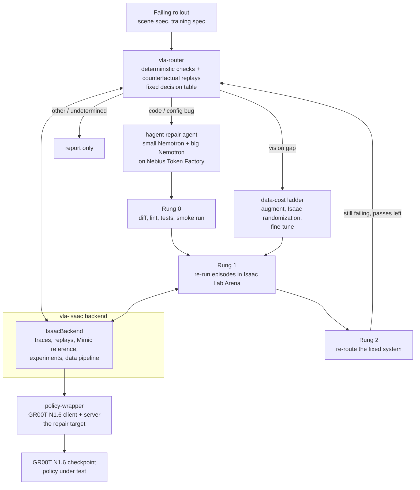

# Penguin Triage

Penguin Triage decides why a vision-language-action (VLA) policy fails a task in Isaac Sim, then repairs the cause with the cheapest tool that works. A deterministic router names the cause (code bug, vision gap, or other). For code bugs, a two-model repair agent (hagent) drives Nemotron models hosted on Nebius Token Factory: a small model does almost every step and a big model is consulted rarely. A verification ladder checks the patch before it is accepted.

Status: built and tested against mocks and fakes, and exercised on a real GPU on 2026-10-29. On that box a stock Arena client with GR00T N1.6 completed episodes, our policy-wrapper client ran 10-episode conditions over several seeds (clean 32/40, BUG-02 0/30, after the hagent fix 28/40, BUG-01 22/30), the router's observation-contract check ran on real frames for two injected bugs (it flagged both), and hagent fixed BUG-02 with Nemotron models on Nebius Token Factory. Everything else is "not run": the router's decision table, replays, other Stage 1 checks, Rung 1 and Rung 2, the incident loop, the pilot gate, `IsaacBackend` end to end, the experiment tools, the data pipeline, fine-tuning and the other 12 injected bugs. The router check was run by a script assembled outside `IsaacBackend`, and the hand-off from router to hagent was manual: the repair tasks were written by hand, and the task that worked contained a localization hint. Scale is small (3 episodes per router condition, 10 per policy-wrapper run). See [Status](#status-what-is-verified), [Router evidence on real frames](#router-evidence-on-real-frames) and [Demo evidence](#demo-evidence) before relying on any claim here.

Built for the NVIDIA Nemotron / open models on Nebius Token Factory hackathon, Physical AI track.

License: MIT for the code written for this project (see [LICENSE](LICENSE)). Files copied from Isaac Lab-Arena stay Apache-2.0. See [License and third-party notices](#license-and-third-party-notices).

## The problem and the idea

A VLA policy fails in simulation. The failure could be in the policy-side code (a swapped colour channel, a wrong action chunk length, a stale normalisation file), in the training data (the policy never saw this lighting), or somewhere that should not be "fixed" (a simulator or asset fault, a skill the policy lacks). Spending a fine-tuning run on a bug that a one-line patch fixes, or patching code when the data is the problem, wastes the whole downstream budget.

The idea:

1. **Route first.** Deterministic checks (observation, action and config contracts, staleness) and counterfactual simulator replays feed a fixed decision table. Models never decide the route (`vla-router/tests/test_no_model_in_routing.py`).
2. **Repair a code bug with a cheap model.** hagent runs a small Nemotron model for nearly every step and consults a big Nemotron model for planning, stuck advice and final review, under a hard call and cost budget.
3. **Verify in a ladder.** Rung 0 checks the patch without the simulator (diff sanity, lint, tests, smoke run, optional reviewer). Rung 1 re-runs episodes in simulation. Rung 2 re-routes the fixed system.
4. **Report, do not fix, the rest.** Action or skill gaps, new sensor modalities and simulator or infrastructure faults are detected and reported. `docs/plan.md` section 2 states this scope.

## Architecture



The router and the ladder talk to the simulator only through a `RolloutBackend` interface (`vla-router/ladder/backend.py`). The router and ladder tests use a `MockBackend`; `vla-isaac` provides the Isaac Lab Arena implementation.

## Components

| Directory | What it is |
|---|---|
| `hybrid-agent/` (git submodule, `ani26052007/hagent`) | **hagent**, a bash-only coding agent in the style of mini-swe-agent with two models. Stdlib only, any OpenAI-compatible endpoint. Hard caps on steps, cost, wall time and big-model calls; a loop detector with a stage-wise escalation ladder; history compaction; an independent final review by the big model. Its own README has the details. |
| `vla-router/` | The router and the verification ladder (`router/`, `ladder/`). Stage 1 checks (observation, action and config contracts, staleness, sanity), behaviour traces, counterfactual replays, the pure `decide(evidence, replays, config)` rule table, Rung 0/1/2, the incident loop, and the hagent repairer that turns a verdict plus evidence into a task and a patch. |
| `vla-isaac/` | The simulation side. `IsaacBackend` for Isaac Lab Arena, scene factor tables, trace sources, the Isaac Lab Mimic reference controller, experiment tools (grid, replay agreement, Wilson/Fisher statistics), the data pipeline and fine-tune launcher, the injected-bug ledger (`bugs/`), and the GPU runbook (`scripts/gpu/`). |
| `policy-wrapper/` | The repair target: a copy of Arena's GR00T N1.6 client (`Gr00tRemoteClosedloopPolicy`) with a `serve.py`, one config file (`config/eval.yaml`) and instrumentation hooks. It is its own git repository and is listed in `.gitignore` of this repo. **It is not in a fresh clone yet.** See the note under [Quick start](#quick-start-laptop-no-gpu). |
| `vla-isaac/bugs/` | The ground truth for evaluation: `ledger.yaml` lists 14 injected bugs (BUG-01 to BUG-14) and 2 combined cases, each with a patch against a fixed policy-wrapper base commit, a symptom, an expected router verdict and the check that should fire. `inject.py` applies them. `detection` says which are covered by GPU-free tests and which need a real run (the `V-bug-*` rows in `docs/VERIFY_ON_GPU.md`). |
| `docs/` | The plan (`plan.md`, `PLAN_UPDATE.md`), the pilot choice (`PILOT_AND_ORDER.md`), the implementation plan and review decisions (`IMPL_PLAN.md`), per-phase build log (`BUILD_STATUS.md`) and the list of facts to confirm on a GPU (`VERIFY_ON_GPU.md`). |
| `external/IsaacLab-Arena` (git submodule) | Isaac Lab Arena at the commit the copied files come from (`7632eb7`). |

The pilot task is the GR1 `put_item_in_fridge_and_close_door` environment with the ranch dressing bottle, checkpoint `nvidia/GN1.6-Tuned-Arena-GR1-PlaceItemCloseDoor-Task`, and dome-light changes as the vision failure family (`docs/PILOT_AND_ORDER.md`, Part 3). The choice stays provisional until the GPU gate described in `vla-isaac/scripts/gpu/run_order.md` is run. The runbook says to switch to the DROID pick-and-place task if the nominal success rate is below 0.8.

## How Nemotron and NVIDIA open models are used

- **Nemotron through Nebius Token Factory, in hagent.** `hybrid-agent/config.toml` sets the endpoint `https://api.tokenfactory.nebius.com/v1/` and the key variable `NEBIUS_API_KEY` for both roles:
  - small model `nvidia/Nemotron-3_5-Lightning` (reasoning off via `chat_template_kwargs`), which drives the main loop and compaction;
  - big model `nvidia/Nemotron-3-Ultra-550b-a55b`, which does the planning consult, stuck advice, takeover steps and the final review.
  The prices in that file are the ones the author configured; they drive the cost cap.
- **Nemotron in the router (planned, not configured).** `docs/plan.md` assigns Nemotron 3 Super to report writing and Rung 2 judging and Nemotron 3 Nano to the training-to-eval config key mapping. `vla-router/router_models.example.toml` holds placeholders for these (`REPLACE_WITH_...` model ids, `integrate.api.nvidia.com` endpoint). The model ids are unverified, and these jobs are optional: routing does not depend on them.
- **GR00T N1.6 is the policy under test**, served through `policy-wrapper/serve.py` from a checkpoint downloaded from Hugging Face. No GR00T code is copied into this repo.
- **Isaac Lab Arena, Isaac Sim, Isaac Lab and Isaac Lab Mimic** provide the environment, the rollout runner and the reference controller. `vla-isaac` drives them through Arena's own entry points.

## Where Nebius Token Factory helped

What the repository supports:

- hagent talks to Token Factory's OpenAI-compatible chat endpoint for both models. Using a hosted endpoint avoids serving a 550B-parameter model (the `Ultra-550b-a55b` id) locally.
- The two-model split is configured against the Token Factory price list (`price_in_per_mtok` / `price_out_per_mtok` in `hybrid-agent/config.toml`), with a cost cap of 1 (`max_cost`) per run.

What was measured on 2026-10-29 (details and caveats under [Demo walkthrough](#demo-walkthrough)): `hagent run --mode hybrid` with `nvidia/Nemotron-3_5-Lightning` (small) and `nvidia/Nemotron-3-Ultra-550b-a55b` (big) on Token Factory fixed an injected bug in 22 small-model calls and 3 big-model calls: about $0.0072 of small-model cost and about $0.0064 of big-model cost (from `usage` in `hagent_bug02_traj.json`), about $0.014 in total. A first attempt with a vaguer task made 65 small-model calls and 4 big-model calls (about $0.044 and $0.026 from `usage` in its trajectory) and edited the wrong file. The trajectory files are not yet in `docs/demo_evidence/`; see [Demo evidence](#demo-evidence).

What the repository does not show: latency or rate-limit measurements, or any SWE-bench Verified run. The small, big and hybrid modes were compared on a separate benchmark (SWE-rebench-V2, 23 tasks; see [hagent benchmark](#hagent-benchmark)), where the big model added nothing measurable in hybrid mode. On the injected-bug demo only one fix on one bug was run. No other Nebius service is used; the GPU box was a cloud VM, and the repository does not record which provider. See `docs/SUBMISSION.md` for the feedback section, which is the author's to fill in.

## Status: what is verified

Real-hardware session on 2026-10-29: NVIDIA RTX PRO 6000 Blackwell Server Edition (sm_120, 97 GB), driver 580.178.04, Ubuntu 22.04, cloud VM. Everything not listed as run there is "not run".

| Component | Tests (GPU-free, mocks and fakes) | Real-hardware status |
|---|---|---|
| hagent (`hybrid-agent`) | 175 passed, 19 skipped (container tests skip without Docker) | **Run live**: many runs on the SWE-rebench-V2 subset (see [hagent benchmark](#hagent-benchmark); results from the author's laptop, Docker backend) and two `--mode hybrid` attempts on one injected bug on the GPU box (local backend). Not run on SWE-bench Verified. The repo's own pytest was not run on the VM (missing dependencies, collection errors). |
| vla-router | 814 passed, 1 skipped against `MockBackend`, scripted hagent models and fixtures | **Observation-contract check run on real frames** (3 episodes per condition, one task; see [Router evidence on real frames](#router-evidence-on-real-frames)). Everything else not run on real data: the decision table, replays, the other Stage 1 checks, Rung 0/1/2, the incident loop and the router LLM jobs. |
| vla-isaac | 631 passed, 1 skipped before this session's changes; 643 passed, 1 skipped after (new Vulkan and cu128 checks, the not_settled client-test report and the router_obs_check smoke tests) | Instrumentation files and trace reading (`read_instrument_dir`) ran on real data. Arena's `policy_runner` ran episodes on `cuda:0` with cameras. `IsaacBackend` end to end, the experiment tools (grid, agreement, mode gap), the data pipeline and the fine-tune launcher: not run. |
| policy-wrapper | 40 passed against `tests/fake_gr00t` | **Run with real GR00T N1.6**: clean 32/40 over 4 seeds (10 episodes each, 1 env per process). `wrapper_parity.sh` printed `parity: true` on 4 episodes, which is not meaningful (intervals too wide); the 50-episode parity run is not run. |
| Stock Arena client + GR00T N1.6 | n/a | 3 of 4 episodes succeeded (object moved 1.0, door moved 1.0). Checkpoint `nvidia/GN1.6-Tuned-Arena-GR1-PlaceItemCloseDoor-Task`, `ranch_bottle_into_fridge`. The documented 0.98 over 50 episodes is not reproduced (only 4 episodes run). |
| Injected bugs | Ledger and patches tested GPU-free where `detection` is `synthetic` or `real-config` | BUG-02 (0/30; router flagged it; fixed by hagent: 28/40) and BUG-01 (22/30; router flagged it; the policy tolerates the channel swap, so it is not a repair demo) were run. The other 12 bugs, the 2 combined cases and BUG-10 (the helper script passes `--language_instruction` on the command line, which overrides `eval.yaml`): not run. |
| Isaac Lab Mimic | override check tested on fixtures | **Fails** at camera init with `--device cpu` and with `--device cuda:0` (`Invalid object in Py_Graph in getWrappedGraphFromNode`). Mimic reference: unverified. |
| Pilot gate (50 episodes, lighting probes) | n/a | Not run. Clean 0.80 over 40 episodes is at the 0.8 threshold, so the gate result is not established. |
| GPU runbook | Headers, env checks, a fake `nvidia-smi`, collector on fixtures | Run on the box: `00_check_gpu`, `R0_setup`, `R1`, `R1b`, `R2_server`, `R3_list_variations`, `wrapper_parity` (4 episodes). `check_client_tests` reported ok but is not settled (collection error in the vla venv, no pytest in the GR00T venv; the script now reports `not_settled`, covered by GPU-free tests only). Not run: `R4`/`R8`/`R7`/`R7b`, `instruction_check`, `runner_parity`, `R5`, `R6`, `finetune_dryrun`. The session mostly ran the underlying commands by hand. |
| Router + hagent end to end | `vla-router/tests/test_loop_hagent.py`: the incident loop with the real `HagentRepairer` and scripted models on a patch-aware `MockBackend` | Not run: the router-to-hagent hand-off was manual (the task texts were written by hand). |

Test counts are from runs on 2026-10-29, using `env -u PYTHONPATH ~/miniconda3/envs/vla-sim/bin/python -m pytest -q` in each directory.

## Quick start (laptop, no GPU)

Nothing here needs Isaac Sim, GR00T, a GPU or an API key. Python 3.11 or newer.

```bash
git clone https://github.com/ani26052007/Penguin_Triage
cd Penguin_Triage
git submodule update --init hybrid-agent        # do not use --recursive: external/IsaacLab-Arena is large and only the GPU box needs it
python3 -m venv .venv && source .venv/bin/activate
unset PYTHONPATH                                 # a sourced ROS sets it, and its pytest plugins break collection

pip install -e "./hybrid-agent[dev]" -e "./vla-router[dev]"

(cd hybrid-agent && pytest -q)                   # hagent
(cd vla-router && pytest -q)                     # router and ladder
python hybrid-agent/examples/demo_offline.py     # hagent fixes a one-line bug with scripted models, prints the patch
```

Mock end-to-end loop (router, ladder and the real hagent repairer on a mock backend, scripted models):

```bash
cd vla-router && pytest -q tests/test_loop_hagent.py tests/test_ladder_loop.py
```

`vla-isaac` and `policy-wrapper` tests need CPU-only torch and the `policy-wrapper` checkout next to this repo. `policy-wrapper` is a separate repository that is **not yet published**:

<!-- TODO(author): publish policy-wrapper and replace this paragraph with the clone or submodule command. -->

```bash
pip install --index-url https://download.pytorch.org/whl/cpu torch==2.14.1
pip install -e ./vla-isaac[test]
# requires ./policy-wrapper (not in a fresh clone yet); then:
(cd vla-isaac && pytest -q)
(cd policy-wrapper && pytest -q)
```

vla-isaac's own README builds its environment as a clone of the author's `vla` conda env. The commands above are the equivalent plain-venv path; they have not been run from a fresh clone.

### Running hagent against Nebius Token Factory

```bash
read -s NEBIUS_API_KEY; export NEBIUS_API_KEY    # never write the key to a file
cd hybrid-agent
hagent run --repo /path/to/git/repo --task "Fix: add() returns the wrong value" --config config.toml --mode hybrid --trajectory out.json
```

`--mode small|big|hybrid` runs the same task with one model or both. The summary line on stderr gives calls and cost per model.

## GPU quick start

The scripts have not been run as a sequence. The sequence is `vla-isaac/scripts/gpu/run_order.md`; read it before spending money. Target: one RTX 6000-class GPU with RT cores and 48 GB or more (A100/H100/H200-class cards are refused: no RT cores), Linux x86_64, `uv` 0.8.4 or newer.

Prerequisites found in the 2026-10-29 session are recorded in `run_order.md` ("Box prerequisites found in the 2026-10-29 session") and summarised in [Hardware notes for Blackwell GPUs](#hardware-notes-for-blackwell-gpus). Isaac Sim needs the NVIDIA Vulkan ICD: install `libnvidia-gl-<driver major>` (`libnvidia-gl-580-server` on that box) and set `VK_ICD_FILENAMES=/usr/share/vulkan/icd.d/nvidia_icd.json` (in `env.example`; `00_check_gpu.sh` and `R0_setup.sh` check it).

```bash
cp vla-isaac/scripts/gpu/env.example ~/vla-env.sh   # edit the paths; keep it outside the repo
source ~/vla-env.sh                                  # sets RUN_TS: scripts share measurements/<RUN_TS>/ (to pin it across shells see run_order.md)
read -s NEBIUS_API_KEY; export NEBIUS_API_KEY        # only if you run hagent on this box
# export HF_TOKEN in your own shell only if the Hugging Face repos turn out to be gated

vla-isaac/scripts/gpu/00_check_gpu.sh                # GPU usable? (Ampere or newer, RT cores, VRAM)
vla-isaac/scripts/gpu/R0_setup.sh                    # Arena, GR00T and vla-isaac venvs, backend config, versions
vla-isaac/scripts/gpu/R1_download_checkpoint.sh      # GR1 pilot checkpoint from Hugging Face
# ... continue in the order of the table in run_order.md (steps 3-16)
```

Set `RUN_TS` once per session so every script writes into the same `measurements/<RUN_TS>/` directory. Scripts are idempotent, write only under `measurements/`, and finish with `result.json` and a `DONE` marker. `collect_measurements.py` (step 16) reports which `VERIFY_ON_GPU.md` rows the runs settled and the pilot decisions. The pilot gate (nominal rate at least 0.8, lighting probes dropping to about 40% or below) is checked after step 10; if it fails, the runbook says to stop and switch to DROID.

### Hardware notes for Blackwell GPUs

Found on the RTX PRO 6000 Blackwell (compute capability 12.0) and not tested on any other card:

1. **Vulkan.** Isaac Sim crashed at camera init until `libnvidia-gl-580-server` was installed and `VK_ICD_FILENAMES=/usr/share/vulkan/icd.d/nvidia_icd.json` was set.
2. **torch in the GR00T venv.** The shipped torch 2.7.1+cu126 has no sm_120 kernels (`no kernel image is available`). Installing `torch==2.7.1+cu128` and `torchvision==0.22.1+cu128` from `https://download.pytorch.org/whl/cu128` fixed it, and flash_attn 2.7.4 worked afterwards. The explicit `+cu128` is required: a plain `==2.7.1` is a no-op in uv.

`R0_setup.sh` now performs the second install when the GPU reports compute capability 12.0, and both scripts check the first; those script changes are covered by GPU-free tests and have not themselves been run.

Other notes from the session:

3. **Arena's nested submodules use SSH URLs.** `R0_setup` needed `git config --global url."https://github.com/".insteadOf git@github.com:` on a box without GitHub SSH keys.
4. **`R2_server.sh | tail` hangs.** The server keeps the pipe open. Redirect to a file instead (`R2_server.sh > r2.log 2>&1`). The server answered ping after 8-14 s.
5. **Start parallel runs 60 s apart.** Three simulators starting at once collided on an HDF5 file lock (h5py "unable to lock file"); the crashed run was rerun alone and succeeded. Three parallel runs peaked at 52 GB VRAM and 98% GPU utilisation.
6. **The VM was a Spot instance and was preempted once.** Results were saved before it went.

## Demo walkthrough

What was run on 2026-10-29: the policy-wrapper client against GR00T N1.6 (`nvidia/GN1.6-Tuned-Arena-GR1-PlaceItemCloseDoor-Task`, `ranch_bottle_into_fridge`), clean mode, 1 env per process, separate processes (up to three in parallel), 10 episodes per seed, seed passed with `--seed`.

1. **Clean run.** policy-wrapper, no bug.
2. **Injected bug.** BUG-02: the image is rotated 180 degrees in `policy_wrapper/policy/gr00t_core.py`, function `build_gr00t_policy_observations`, by `[:, ::-1, ::-1]`.
3. **Bugged run.** The policy succeeds in no episode.
4. **hagent fix.** `hagent run --mode hybrid`, small `nvidia/Nemotron-3_5-Lightning`, big `nvidia/Nemotron-3-Ultra-550b-a55b`, both on Nebius Token Factory, local backend (the VM had no Docker), `hybrid-agent/config.toml`.
5. **Fixed run.** The same protocol (seeds 1-4, 10 episodes each) after applying the patch. The fixed repo was verified byte-identical to the clean repo (`diff -rq`).
6. **BUG-01 for contrast.** `config/eval.yaml` `bgr_conversion` false to true (RGB/BGR swap).

| Condition | Per-seed successes (of 10) | Success | Object moved | Door moved |
|---|---|---|---|---|
| policy-wrapper, clean | seeds 1-4: 9, 8, 9, 6 | 32/40 = 0.80 (Wilson 95% about 0.65-0.90) | 1.0 on all | 1.0 on all |
| policy-wrapper, BUG-02 | seeds 1-3: 0, 0, 0 | 0/30 = 0.0 | 0.0 | 0.0 |
| policy-wrapper, after hagent fix | seeds 1-4: 7, 8, 6, 7 | 28/40 = 0.70 | about 1.0 (0.9 for one seed) | 1.0 |
| policy-wrapper, BUG-01 (channel swap) | seeds 1-3: 7, 9, 6 | 22/30 = 0.73 | 1.0 | 1.0 |
| stock Arena client (4 episodes) | one run | 3/4 | 1.0 | 1.0 |

Reading the table: the bug removes every success and both behaviour rates fall to 0.0; after the fix success is back in the clean range and both behaviour rates are back to about 1.0. Clean 32/40 against fixed 28/40 is a difference within noise (Fisher p about 0.4), and the two repos are byte-identical, so the 0.70 vs 0.80 gap is run-to-run variation, not a residual defect. This is not "fully recovered" with a demonstrated rate. BUG-01 is **not** a fix demonstration: the policy tolerates the channel swap (22/30 is within the clean range), although the router flags it (below). Task completion fractions are reported as measured; their definitions are Arena's.

Footnote: earlier seed-0 runs with 8 episodes (clean 5/8, BUG-02 0/8, fixed 4/8) are superseded by the runs above.

Video: Arena's `--record_camera_video` records the simulator's robot point-of-view camera, not the image the client sends to the model, so the bugged clip looks like a normal scene with a flailing robot. It does not show an upside-down view.

The hagent attempts (costs from `usage` in the trajectories):

| Attempt | Task | Small-model calls (cost) | Big-model calls (cost) | Outcome |
|---|---|---|---|---|
| 1 | Vague ("observation path"), `task_bug02.md` | 65 (about $0.044) | 4 (about $0.026) | `exit_status` Submitted but wrong: edited `policy_wrapper/utils/image_conversion.py`; the flip was still present |
| 2 | Names `policy_wrapper/policy/gr00t_core.py` and `build_gr00t_policy_observations`, `task_bug02b.md` | 22 (about $0.0072) | 3 (about $0.0064) | `exit_status` Submitted; removed `[:, ::-1, ::-1]` and nothing else (`bug02_fix.patch`, 14 lines) |

### Router evidence on real frames

The router's `ObservationContractCheck` (unchanged code) was run on real instrument files from the GPU box: `policy_wrapper.instrument` with `VLA_INSTRUMENT_DIR`, a frame every 5 steps (21 frames per episode), camera `ego_view`, read with `read_instrument_dir` and wrapped into `EpisodeTrace` objects. The nominal was built from 3 clean episodes (seed 11) with the same `obs_nominal` as `vla-isaac/tests/bugs_support.py`.

| Run | Episodes | Evidence items |
|---|---|---|
| held-out clean (seed 12, not used for the nominal) | 3 | 0 |
| BUG-02 (image rotated 180 degrees) | 3 | 1: `s1.obs.orientation.ego_view`, `contract_violation`, strength 0.99, "image looks like a rotation by 180 degrees of the training orientation (row/col profile correlation 0.22/-0.81)" |
| BUG-01 (RGB/BGR swap) | 3 | 1: `s1.obs.channel_order.ego_view`, strength 1.00, "order appears to be BGR instead of RGB (opponent-vector distance 6.99 ...)" |

Both evidence ids match the ledger's expected ids for BUG-01 and BUG-02. The BUG-01 result is a detection of a contract violation that the policy tolerates: the router flags it, the policy still succeeds in 22/30.

Rerun (on the box, in the vla-isaac venv, with the instrument directories left by `record_cell.sh` runs; the first argument builds the nominal, each further argument is checked against it):

```bash
python vla-isaac/scripts/gpu/router_obs_check.py <clean_seed11_dir> <clean_seed12_dir> <bug02_dir> <bug01_dir>
```

`record_cell.sh` and `router_obs_check.py` come from the 2026-10-29 session and ran only there; `vla-isaac/tests/test_router_obs_check.py` checks the script GPU-free on synthetic fixture frames.

Caveats: 3 episodes per condition, one task, a nominal from 3 episodes, and a script assembled outside `IsaacBackend` (the router loop did not drive the run). Only the observation-contract check was run. The decision table, replays, the other Stage 1 checks, Rung 1/2 and the incident loop were not run on real data. The original run read `router_check3.py` and `router_check.py` from the author's home directory; the committed script folds both into one.

### What the demo does and does not show

It shows detection on real frames (the observation check flags both injected bugs and stays silent on a held-out clean run, at 3 episodes each), and repair by Nemotron on Token Factory (a small model with a few big-model consults removed the bad line). It does not show the system locating a bug: the router-to-hagent hand-off was manual, the task texts were written by hand in router style from measured results, and attempt 2 contained a localization hint (the file and function). After the router check the orientation evidence is real and supports the task's "observation path" statement, but the router did not produce the task. The repo's own pytest was not run on the VM; the Phase 8 suite on the laptop covers the silent-bug claim.

The intended full loop, not run end to end on real hardware: the router runs the Stage 1 checks and replays and names the verdict and location (for BUG-02 the ledger expects `code`); the verdict and evidence become the hagent task; Rung 0 checks the patch, Rung 1 re-runs episodes, and Rung 2 re-routes the fixed system. For a combined case (CASE-01), the ledger expects the first fix to expose a second cause, which the second pass routes to `vision`.

## hagent benchmark

hagent has been run live many times; it has not been run on SWE-bench Verified. The benchmark is a SWE-rebench-V2 subset of 23 tasks: 13 "fair" (the issue text specifies what the hidden tests check), 4 mismatched and 6 ambiguous. Modes small, big and hybrid, temperature 0, `max_steps` 80, Docker backend with workdir `/<repo>`, Nebius Token Factory. Measured 2026-10-25 to 2026-10-28 on the author's laptop (source: `HANDOFF_v2.md`).

Fair set, 3 runs of small and 3 runs of hybrid: **small 14/39, hybrid 13/39.** Hybrid did not beat small, and the big model added nothing measurable in hybrid mode. Noise between identical runs is about +-2 tasks.

| Task | Resolved (of 6 runs, small + hybrid) |
|---|---|
| werkzeug-2126, traitsui-1554 | 6/6 each |
| cloud-sql, aiohttp-8742 | 5/6 each |
| traits-927 | 3/6 |
| gitpython-1832, ctfd-2751 | 1/6 each |
| sphinx-needs-1102, aiohttp-7368, cfn-lint-2470, cxxheaderparser-50, werkzeug-2979, narwhals-2372 | 0/6 each |

- Multi-site fixes cover only the first location. sphinx-needs-1102 and aiohttp-7368 failed identically in every configuration because the model took the issue's example or the reporter's guess as the full spec (checked against the hidden tests: both are solvable from the issue).
- Ultra as the driver did worse than Lightning (mini-swe-agent `big_tb`: 1/23). mini-swe-agent with Lightning solved about 5 of 23, in the same range as hagent.
- Harness patches 1-6 removed format-error and token-cap deaths and cut no-edit runs from 5 to 0-4, but did not change the resolved count.

The benchmark artifacts live outside this repository (`rebench/` on the author's laptop) unless copied into `docs/hagent_benchmark/`; they are not there yet. Files to copy there: the per-run trajectories, the score tables (per task and mode) and the `analysis/` directory; then link them here.

## Demo evidence

`docs/demo_evidence/` does not exist in the repository yet: no evidence file has been copied in, so none is listed as present. Files the 2026-10-29 session produced, on the author's machine and to be copied there:

- `bug02_fix.patch`, `task_bug02.md`, `task_bug02b.md`: the patch of attempt 2 and the two hand-written task texts.
- `hagent_bug02_attempt1_traj.json`, `hagent_bug02_traj.json`: the two hagent trajectories.
- `router_check.py`, `router_check3.py` (the committed version is `vla-isaac/scripts/gpu/router_obs_check.py`), `router_check3_output.txt` (and `router_check_output.txt`, the earlier two-condition output), `record_cell2.sh` (committed as `vla-isaac/scripts/gpu/record_cell.sh`).
- The router instrument directories (`router_ev/clean`, `clean2`, `bugged`, `bug01`: `env*_ep*.json`).
- Arena logs and summaries of the parallel runs (`par_*`: `arena.log`, `episode_results_rank0.jsonl`), the clean/bugged/fixed 8-episode runs (footnoted above) and the stock-client run.
- Videos (`robot-cam-env0-robot_pov_cam_rgb-episode-*.mp4`): simulator POV, not the client's image.

## Known limitations

From `docs/BUILD_STATUS.md`, "Current state" and Phase 8 "Limitations" (not softened):

- A stripped recorded-variation file is not replayed through `IsaacBackend`; restoring a factor live covers the same need.
- The staleness checks see only action-side delay.
- `FrameStats.missing_texture_fraction` is not measured.
- The Mimic override check is indirect (camera brightness), because Mimic records no variations. It reports `inconclusive`, not pass, when frames are missing or all black.
- The GR1 hand sign and the joint-YAML swap are detectable only by elimination.
- The Docker path of the repairer has not been run (no image; `vla-router/DECISIONS.md`); the session's hagent runs used the local backend.
- The demo's repair task was written by hand with a localization hint; the router-to-hagent hand-off has not run on real data.
- Router evidence on real frames is 3 episodes per condition on one task, with a nominal from 3 episodes, from a script outside `IsaacBackend`; only the observation-contract check ran.
- BUG-01 (channel swap) is flagged by the router but tolerated by the policy (22/30): detection of a violation is not detection of a failure cause.
- policy-wrapper results are 10 episodes per seed over 3-4 seeds (stock client: 4 episodes). The pilot gate (50 episodes) is not established: clean 0.80 over 40 episodes is at the 0.8 threshold. `parity: true` on 4 episodes is not meaningful, and wrapper parity at a meaningful size is not run.
- Isaac Lab Mimic fails at camera init with both `--device cpu` and `--device cuda:0` (`Invalid object in Py_Graph in getWrappedGraphFromNode`, "Unable to create prim for graph at /Render/PostProcess/SDGPipeline"), so the Mimic reference is unverified. Mimic uses `gr1_pink` while `policy_runner` uses `gr1_joint` and creates cameras fine; that difference is a hypothesis, not tested.
- Arena's `--record_camera_video` records the simulator camera, not the client's (rotated) image.
- `check_client_tests` is not settled (collection error in the vla venv; no pytest in the GR00T venv).
- On hagent: on the SWE-rebench-V2 fair set hybrid (13/39) did not beat small (14/39); see [hagent benchmark](#hagent-benchmark).
- The pilot is a composite task (pick and place, then close door). Its close-door subtask has no slot in `BehaviorTrace.PHASES`, the GR1 scene has no camera-variation family, and the documented 0.98 success may come from a 1-GPU or 2-GPU run (`docs/PILOT_AND_ORDER.md`).
- The agent runs arbitrary bash. Use the container backend for anything untrusted. hagent is POSIX only.
- Costs and token budgets are only as accurate as the configured prices; with prices at 0 the cost cap never triggers.
- Everything under [Status](#status-what-is-verified) marked "not run" is unmeasured. Expect further GPU runs to find defects.

## License and third-party notices

- Code written for this project: MIT (`LICENSE`). `hybrid-agent/` is a separate repository and currently has no license file of its own (the root `LICENSE` does not cover it). `policy-wrapper/` declares Apache-2.0.
- Files copied from Isaac Lab-Arena (commit `7632eb7d5e`, Apache-2.0, copyright The Isaac Lab Arena Project Developers) keep their original headers. They are listed in `vla-isaac/NOTICE` and in `policy-wrapper/NOTICE`, with the changes made to each.
- **Isaac-GR00T is licensed under the NVIDIA License and no part of it is copied into this repository.** `policy-wrapper/serve.py` imports it at run time from a separate install; `policy-wrapper/tests/fake_gr00t` holds test stand-ins written here.
- Isaac Sim requires accepting the Omniverse EULA (`OMNI_KIT_ACCEPT_EULA=YES`, `ACCEPT_EULA=Y`). Model checkpoints and datasets are downloaded from Hugging Face under their own terms and are not redistributed here.
